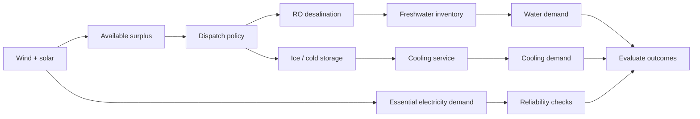
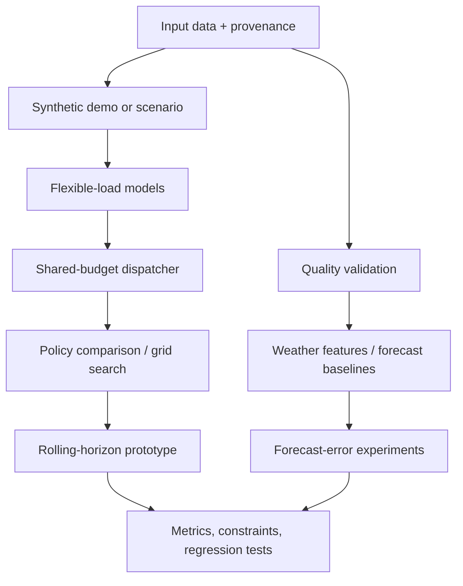
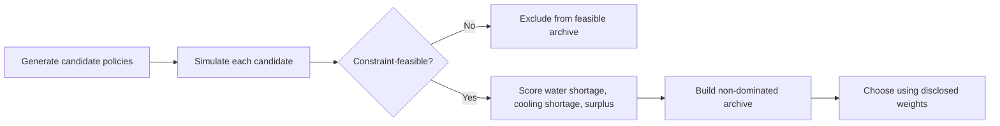

# islandOS — AI Island Energy Brain

<p align="center">
  <strong>Turn renewable-energy surplus into useful island resources.</strong><br>
  A simulation-first toolkit for flexible-load dispatch, water–energy co-simulation, and forecast-aware planning research.
</p>

<p align="center">
  <a href="https://github.com/HaochuanLin/islandOS/actions/workflows/ro-tests.yml"></a>
  
  
  
</p>

IslandOS explores a practical question: **when wind and solar exceed immediate electricity demand, can a controller use part of that surplus to produce resources an island needs—without sacrificing essential services?**

The repository now contains a runnable synthetic demo, experimental flexible-load models and dispatch tools, data-quality checks, a NASA POWER weather-data adapter, and forecast-baseline evaluation scripts. It is an **early-stage software prototype**: no field deployment or validated real-island performance is claimed.

## Example visualization

<p align="center">
  
</p>

<p align="center"><em>Illustrative simulation output only; synthetic results are not field measurements or evidence of real-island performance.</em></p>

---

## At a glance

| | What is in the repository today |
|---|---|
| ⚡ **Energy dispatch** | Shared-budget, priority-based flexible-load dispatcher |
| 💧 **Water** | Experimental reverse-osmosis (RO) and freshwater-inventory model |
| ❄️ **Cooling** | Simplified ice-making / cold-storage load prototype |
| 🌦️ **Data** | NASA POWER hourly environmental-data importer and strict CSV quality gate |
| 📈 **Forecast evaluation** | Persistence and 24-hour seasonal-naive baselines with chronological holdout and multi-window evaluation |
| 🧪 **Experiments** | Policy comparisons, grid search, forecast-error sensitivity, rolling-horizon prototype, objective-weight audit |
| ✅ **Verification** | Unit and regression tests plus GitHub Actions |

> **Honest status:** some components are implemented as prototypes, not integrated into one validated end-to-end controller. Forecast baselines predict a NASA POWER weather parameter—not island PV output, wind generation, or electricity demand. See the [capability matrix](#implementation-status) and [limitations](#limitations).

## The core idea

A battery stores electricity. IslandOS also investigates **shifting flexible electricity consumption in time** so surplus energy can create useful local resources.



**Physical boundary:** freshwater is stored for water supply; it is not converted back into electricity. Flexible loads can shift demand, but they do not automatically replace batteries, backup generation, or grid-forming equipment.

## How the code fits together



The diagram shows the **research workflow**, not a claim that every stage is already connected in a production pipeline. The rolling-horizon experiment uses synthetic scenarios and simple baseline/error patterns; the weather-data workflow is separate from actual island load and generation data.

## What you can run

| Goal | Command | What it demonstrates |
|---|---|---|
| Run the original 24-hour demo | `python island_microgrid_ro_sim.py` | Synthetic wind/PV/load, rule-based RO dispatch, freshwater inventory, plot output |
| Compare flexible-load policies | `python experiments/compare_dispatch_policies.py` | RO-only, cold-storage-only, and two priority orders across synthetic scenarios |
| Generate a visual experiment report + physical audit | `python experiments/generate_dispatch_report.py --output-dir build/dispatch-report` | SVG chart, CSV/JSON results, Markdown summary, and hourly `audit_report.json` |
| Inspect candidate trade-offs | `python optimization/grid_search_optimizer.py` | Small exhaustive policy search, feasibility filtering, Pareto archive, weighted recommendation |
| Test forecast-error sensitivity | `python experiments/forecast_error_robustness.py` | How perturbed surplus forecasts affect policy selection |
| Run the rolling-horizon prototype | `python experiments/rolling_horizon_dispatch.py` | Re-plan over a short window and compare against fixed-priority baselines |

The rolling-horizon prototype carries the RO minimum-run commitment between hourly replans and reports a violation if a committed hour lacks enough renewable power. This remains a simplified commitment model: it does not model plant interlocks, startup/ramp dynamics, or site-specific operating limits.
| Audit objective weights | `python experiments/weight_sensitivity_audit.py` | Re-score the same synthetic outcomes under alternative illustrative weights |
| Validate a time-series CSV | `python data_quality.py path/to/data.csv --source-type public` | Checks schema, values, timestamp order and interval spacing |
| Download NASA POWER weather data | See [data workflow](#weather-data-and-forecast-baselines) | Saves hourly environmental parameters and provenance metadata |
| Run all regression tests | `python -m unittest discover -s tests -v` | Checks selected model invariants and edge cases |

### Quick start

```bash
git clone https://github.com/HaochuanLin/islandOS.git
cd islandOS
python -m venv .venv

# Windows PowerShell
.venv\\Scripts\\Activate.ps1

# macOS / Linux (use this instead of the Windows command)
source .venv/bin/activate

pip install -r requirements.txt
python island_microgrid_ro_sim.py
```

The original demo uses synthetic inputs and writes a plot named `island_microgrid_ro.png`.

### Reproducible dispatch report

The report generator reruns the same 3 synthetic scenarios × 4 dispatch policies used by the comparison experiment. It produces:

- `REPORT.md` — compact results table and interpretation limits
- `dispatch_comparison.svg` — grouped charts for remaining surplus, unmet water demand, and unmet cooling demand
- `results.csv` and `results.json` — machine-readable outputs

The GitHub Actions workflow runs regression tests, generates the reports, and uploads the files as the `islandos-dispatch-report` artifact (retained for 30 days). The audit verifies internal accounting and configured bounds only; it is not proof of plant safety, site-specific feasibility, or model accuracy. Open [the latest workflow run](https://github.com/HaochuanLin/islandOS/actions/workflows/ro-tests.yml) and download the artifact after a successful run. These results are synthetic and must not be presented as field measurements.

To run the regression suite:

```bash
python -m unittest discover -s tests -v
```

## The optimization loop (prototype)



The current optimizer exhaustively searches a **small discrete policy space**: two priority orders × four RO minimum-run durations. The recommendation is selected from the same evaluated Pareto archive. This is a connected, reproducible optimization baseline—not machine learning, NSGA-II, or a global optimum over every possible hourly schedule.

## Weather data and forecast baselines

IslandOS includes a NASA POWER hourly importer for `ALLSKY_SFC_SW_DWN`, `T2M`, and `WS10M`, with a provenance sidecar. Example:

```bash
python data_sources/nasa_power_hourly.py \\
  --latitude -35.2 --longitude -63.5 \\
  --start 20200101 --end 20200107 \\
  --output data/raw/nasa_power_hourly.csv
```

The coordinates and dates above are examples only. Consult the [NASA POWER hourly API documentation](https://power.larc.nasa.gov/docs/services/api/temporal/hourly/) and verify the units reported in the downloaded metadata.

Prepare environmental features:

```bash
python data_sources/prepare_environmental_features.py \\
  data/raw/nasa_power_hourly.csv \\
  --output data/processed/nasa_environmental_features.csv
```

Evaluate simple one-hour-ahead weather-parameter baselines:

```bash
python experiments/forecasting_baselines.py \\
  data/raw/nasa_power_hourly.csv \\
  --output data/processed/forecast_baselines.csv
```

The first script compares persistence with a 24-hour seasonal-naive baseline using chronological holdout and multiple chronological test windows. It reports MAE, RMSE and bias with output metadata. To add a small trained model, run:

```bash
python experiments/train_weather_forecaster.py \
  data/processed/forecast_baselines.csv \
  --output data/processed/trained_weather_forecast.csv
```

The trained model is ordinary least-squares regression using cyclical timestamp features and 1-, 3-, and 24-hour lags. It fits only on the chronological history partition and compares its holdout MAE/RMSE/bias against both simple baselines. The first 24 rows are omitted again because the exported baseline CSV begins after its own 24-hour warm-up. Positive `mae_skill_vs_best_baseline` means lower holdout MAE than the best simple baseline; a negative value means it performed worse. This is a **trained weather-parameter prototype**, not an island energy forecast or evidence of operational benefit. It does not generate missing PV/wind output or demand data.

## Implementation status

| Capability | Status | What the status means |
|---|---|---|
| Synthetic 24-hour RO demo | **Implemented** | Runnable demonstration with simplified physics |
| Freshwater reservoir balance | **Implemented / simplified** | Inventory accounting, not a site-calibrated plant model |
| RO and cold-storage plug-ins | **Experimental** | Tested interfaces and simplified component models |
| Shared-budget dispatcher | **Experimental** | Sequential allocation in explicit priority order |
| Grid-search / Pareto policy selection | **Experimental** | Small candidate space and illustrative objective weights |
| NASA POWER importer + provenance | **Implemented** | Environmental data only; not island generation or demand |
| CSV quality gate and feature preparation | **Implemented** | Structural checks and lag features; no automatic imputation |
| Persistence / seasonal-naive evaluation | **Implemented baseline** | Chronological evaluation of a weather parameter |
| Trained weather-parameter regression | **Experimental** | Least-squares model, lag/time features and chronological holdout; not connected to dispatch |
| Integrated, trained forecast-and-dispatch AI | **Not yet implemented** | Requires validated renewable/load targets, forecast-aware dispatch integration and end-to-end evaluation |
| Site economics, lifecycle emissions and field validation | **Not available** | Requires real data, engineering assumptions and external validation |

## Metrics that matter

| Metric | Why track it? |
|---|---|
| Renewable surplus remaining / curtailment (kWh) | Measures unused energy in the modelled boundary |
| Essential electricity not served (kWh) | Prevents “better utilization” from hiding reliability losses |
| Freshwater produced and unmet demand (m³) | Measures water-service outcomes |
| Cooling served and unmet demand (kWhₜₕ) | Measures the cold-storage service trade-off |
| Backup energy and constraint violations | Exposes infeasibility rather than hiding it |
| Forecast MAE, RMSE and bias | Tests whether a forecast beats transparent baselines |
| Operating cost / emissions | Add only when source data and calculation boundaries are defined |

Reducing surplus is not automatically a win if water or cooling demand goes unmet, essential power becomes unreliable, or equipment constraints are violated.

## Limitations

- All dispatch and policy-comparison scenarios currently use synthetic profiles; NASA POWER data are environmental covariates, not measured island load or generation.
- Some experiments are separate prototypes rather than one end-to-end integrated system.
- The dispatcher uses explicit priority order; it does not jointly optimize all hourly decisions.
- The optimizer explores a small candidate space and uses illustrative objective weights that have not been validated by island operators.
- The RO model omits important plant effects such as membrane fouling, flushing, ageing and detailed variable-load behaviour.
- The cold-storage model omits thermal leakage, detailed refrigeration dynamics and site-specific operating constraints.
- A complete island electrical model with diesel generation, battery dynamics, network constraints and protection systems is not implemented.
- Cost, emissions reductions, battery-life extension and real-world resilience benefits have not been quantified.

## Repository map

| Path | Purpose |
|---|---|
| `island_microgrid_ro_sim.py` | Original synthetic RO demo |
| `flexible_loads.py` | Experimental RO and cold-storage models |
| `dispatch_engine.py` | Shared-budget priority dispatcher |
| `optimization/grid_search_optimizer.py` | Candidate search and Pareto-based recommendation |
| `experiments/` | Reproducible synthetic policy and forecast experiments |
| `data_quality.py` | Strict CSV time-series validation |
| `data_sources/` | NASA POWER import and environmental feature preparation |
| `tests/` | Unit and regression tests |
| `docs/AI_ARCHITECTURE.md` | Design boundaries, workflow and development principles |

## Development principles

1. Make assumptions and data provenance explicit.
2. Preserve essential-service and equipment constraints.
3. Compare new strategies against transparent baselines.
4. Test physical/accounting invariants and edge cases.
5. Separate measured, public, forecast and synthetic data.
6. Do not describe an experimental prototype as a deployed or validated AI system.

## License

MIT — see [LICENSE](LICENSE).
