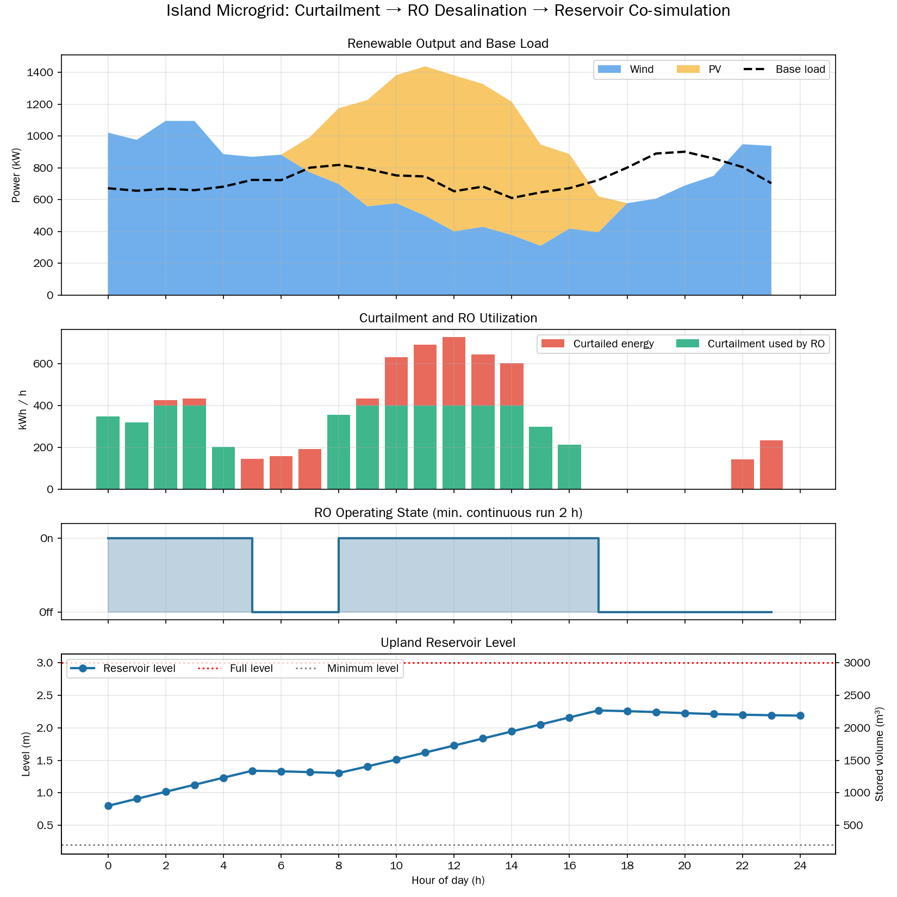

# IslandOS: Plug-in energy–water decision platform for island freshwater resilience

<p align="center">
  <strong>A modular, plug-in simulation and decision platform for island energy–water resilience.</strong><br>
  Rule-based look-ahead scheduling explores when surplus wind/solar electricity can drive modular reverse osmosis (RO) and build an emergency freshwater buffer while protecting essential electricity demand.
</p>

<p align="center">
  <a href="https://github.com/HaochuanLin/islandOS/actions/workflows/ro-tests.yml"></a>
  
  
</p>

**islandOS is an early-stage research prototype, not a deployed island control system.** Its product architecture is designed to be plug-in: normalized data adapters, site configuration, forecast reports, and decision policies can be replaced at documented boundaries without rewriting the dispatch core. It helps users explore when flexible loads—such as reverse-osmosis (RO) desalination and cold storage—might use renewable surplus while tracking water service, energy use, and simplified equipment constraints. Site-specific signal mapping, units, safety limits, and validation are still required; this is not yet a universal drop-in plant controller.

**Try the hosted interactive demo:** [Open IslandOS](https://islandos.streamlit.app/). The app is intended to be directly accessible; if the hosted service is temporarily unavailable, use the [local demo deployment runbook](docs/DEMO_DEPLOYMENT.md) to run it locally. Before startup, run `python tools/deployment_preflight.py` to check the local demo's loopback binding, pinned container base, non-root user, health check, SBOM configuration, and documented security boundary. The built-in example is synthetic; this is a planning/simulation prototype, not a live island control system.  
Use the interactive app to explore energy–water dispatch strategies, adjust RO and storage assumptions, compare water and energy outcomes, and export results. You can start with the built-in synthetic example or upload an hourly CSV for your own scenario. The built-in example is illustrative, not measured island data; uploaded data is analyzed as supplied. IslandOS is a planning and simulation prototype, not a live island control system.


<p align="center">
  
</p>
<p align="center"><em>Illustrative synthetic simulation only—not field measurements or evidence of real-island performance.</em></p>

## Experimental pilot scenario: Nan'ao emergency desalination case

A frozen snapshot of this Nan'ao pilot case is available on branch: `nan-ao-scenario-pilot`.

It is implemented in `nan_ao_scenario.py`, using a 50 kW / 4.0 kWh/m³ event-energy scenario with 1,000 Monte Carlo runs and fixed seed 20261021.

All outputs are synthetic scenario assumptions, not measured real-world data.

The interactive `app.py` on main is a generic conceptual demo only, and does not generate the quantitative results from this pilot case.

## What it can do today

- **Interactive strategy screening:** choose synthetic demo data or upload hourly site data; adjust key RO and water-tank assumptions; compare strategies; inspect hourly outcomes; export results.
- **Energy–water dispatch experiments:** compare priority-based flexible-load policies and run a rolling-horizon prototype. The RO simulator also accepts explicit surplus and water-demand forecasts; `python experiments/evaluate_forecast_driven_ro_sim.py` measures forecast-error impacts against an optimistic perfect-foresight reference.
- **Multi-objective policy search:** use grid search or an experimental NSGA-II optimizer to inspect trade-offs among unmet water/cooling demand and remaining renewable surplus.
- **Plug-in forecasting:** register replaceable demand-forecast models through a dependency-free runtime contract with timestamp/value validation and input provenance. Run `python examples/forecast_plugin_example.py` for a minimal example, or `python experiments/backtest_forecast_plugin.py data/processed/your_hourly.csv --plugin your_package.forecast:MyPlugin` to produce a rolling-origin report that the existing forecast-to-dispatch adapter can consume. Only import trusted plugin code. Optional PyTorch LSTM/GRU neural candidates and gradient boosting are compared offline before any review or promotion.
- **End-to-end forecast-to-dispatch demo:** run `python tools/run_forecast_dispatch_demo.py --hours 168 --seed 20261024 --output-dir build/forecast-dispatch-demo` to connect a replaceable water-demand forecast plug-in to all five dispatch strategies, compare rolling forecasts with an offline realized-demand reference, and export a hash-audited report plus hourly CSVs. **Only water demand is forecast by this workflow**; renewable availability, grid/tariff flags, diesel-displacement potential, and backup availability are supplied as timestamp-aligned input values, not forecasts. The resulting comparison is not a fully forecast-driven operational schedule. The built-in trailing-day mean is a baseline, not a trained model; see [Experiments and workflows](docs/EXPERIMENTS_AND_WORKFLOWS.md).
- **Data preparation:** validate time-series CSVs and import selected public weather, measured microgrid, and monthly planning datasets with provenance notes.
- **Read-only telemetry prototype:** validate and normalize recorded sensor/gateway data, run recommendation-only dispatch analysis, and expose a loopback-only HTTP review dashboard. It performs no PLC writes or actuator control.
- **Site-readiness gate:** fail closed when required site inputs are incomplete or telemetry is stale, and separate input completeness from engineering safety or field approval.
- **Reproducible checks:** run unit/regression tests and synthetic benchmark workflows through GitHub Actions.

The new CLI demo connects a replaceable water-demand forecast plug-in to dispatch screening and auditable strategy comparisons. The broader forecasting experiments still do **not** provide validated island solar/wind generation and electricity-demand forecasts to a live controller; no validated or safety-certified end-to-end controller is claimed.

## Try the interactive app

**No site data yet?** Run the full command-line demonstration in one step; it generates synthetic hourly inputs, compares five strategies, and writes summary, timestep audit, and machine-readable report files:

```bash
python tools/run_synthetic_site_demo.py --hours 168 --seed 20261023
```

Outputs go to `build/synthetic-site-demo/`. The input manifest records the seed, row count, time range, schema, and SHA-256 digest. To initialize equipment/storage assumptions from a parameter JSON, pass `--config config/site_parameters.example.json`; `--specific-energy-kwh-m3`, `--tank-capacity-m3`, and `--initial-water-m3` override the corresponding values. RO screening power remains an explicit CLI assumption because the configuration's search-space ratings are candidate values, not necessarily the same scale as the synthetic fixture. To generate only a CSV for app upload, use:

```bash
python tools/generate_synthetic_site_csv.py --output build/synthetic_site_hourly.csv --hours 168 --seed 20261023
```

Both workflows use synthetic onboarding data only—not a forecast, measured site data, or an operational recommendation. A hash proves file identity, not measurement authenticity.

From the repository root:

```bash
python -m venv .venv
# Windows PowerShell:
.venv\\Scripts\\Activate.ps1
# macOS / Linux:
source .venv/bin/activate

pip install -r requirements.txt
streamlit run app.py
```

The app opens in your browser on your own machine. You can also try the hosted version at [islandos.streamlit.app](https://islandos.streamlit.app/); the deployed version may not update until the hosting service finishes redeploying.

In the app, you can:
1. Use the clearly labeled synthetic demo or upload an hourly CSV.
2. Set RO power, specific energy, water-tank capacity and initial inventory, minimum run time, and optional cost assumptions.
3. Compare fixed operating strategies and review summary metrics, water outcomes, and hourly audit rows.
4. Run the experimental NSGA-II search, inspect feasible candidates and trade-offs, and download reports.
5. Open the separate **Rolling-horizon dispatch lab** page to compare rolling, fixed-priority, and perfect-information reference policies on a paired hourly CSV.
6. Download a CSV template from the data guide.

**Uploaded data:** the strategy-screening app expects `timestamp`, `renewable_surplus_kw`, `diesel_displacement_potential_kw`, `grid_price_per_kwh`, `off_peak`, `grid_available`, and `water_demand_m3`. The optional `backup_available_kw` column describes an assumed available backup-power limit. See [the app's data guide](docs/ENERGY_WATER_STRATEGY_COMPARISON.md); values and units must be appropriate for your site. Missing values are not silently imputed.

## Quick start: generic 24-hour demo

Install the dependencies and run the general-purpose 24-hour synthetic isolated-island demo (400 kW RO rating; 3.5 kWh/m³ specific energy assumption):

```bash
pip install -r requirements.txt
python island_microgrid_ro_sim.py
```

This is the generic demonstration. All outputs are synthetic simulation results, not field measurements.

For a concrete definition of plug-in compatibility, reproducibility, forecast evaluation, and release evidence, see the [Plug-in acceptance checklist](docs/PLUGIN_ACCEPTANCE_CHECKLIST.md). For a compact reference to the other experiments, see [Experiments and workflows](docs/EXPERIMENTS_AND_WORKFLOWS.md).

## Documentation

- [Plug-in forecast models and end-to-end backtesting](docs/PLUG_AND_PLAY_FORECAST_MODELS.md)
- [Forecast-driven RO simulation and forecast-error evaluation](docs/FORECAST_DRIVEN_SIMULATION.md)
- [Release and deployment checklist](docs/RELEASE_CHECKLIST.md)
- [Changelog](CHANGELOG.md)

- **Dataset provenance validation:** [metadata schema, SHA-256 artifact checks, and command-line workflow](docs/DATASET_PROVENANCE.md)
- **Engineering maturity and delivery gates:** [scored targets, acceptance criteria, and evidence requirements](docs/ENGINEERING_MATURITY_ROADMAP.md)
- **Release acceptance checklist:** [exact-SHA CI evidence, data integrity, deployment rollback, and field-operation gates](docs/RELEASE_ACCEPTANCE_CHECKLIST.md)
- **Plug-and-play platform roadmap:** [modular decision core, signal adapters, configuration, safety boundaries, and local deployment](docs/PLUG_AND_PLAY_PRODUCT_ROADMAP.md)

| Topic | Guide |
|---|---|
| Local Docker / demo deployment, health checks, and shutdown | [Demo deployment runbook](docs/DEMO_DEPLOYMENT.md) |
| Sensor message schema and adapter boundary | [Sensor adapter contract](docs/SENSOR_ADAPTER_CONTRACT.md) |
| Site input completeness and fail-closed scenario gate | [Site readiness gate](docs/SITE_READINESS_GATE.md) |
| Staff-entered data and provenance workflow | [Staff data-entry guide](docs/STAFF_DATA_ENTRY.md) |
| Productization milestones and non-goals | [Productization roadmap](docs/PRODUCTIZATION_ROADMAP.md) |
| Site-specific validation gates and sign-offs | [Supervised pilot acceptance plan](docs/SUPERVISED_PILOT_ACCEPTANCE_PLAN.md) |
| Read-only telemetry validation and device mapping | [Telemetry integration contract](docs/TELEMETRY_INTEGRATION_CONTRACT.md) |
| Deployment boundaries and future hardware adapters | [Hardware integration architecture](docs/HARDWARE_INTEGRATION_ARCHITECTURE.md) |
| Interactive app inputs and strategy assumptions | [Energy–water strategy comparison](docs/ENERGY_WATER_STRATEGY_COMPARISON.md) |
| Primary Streamlit app upload schema, exports, provenance, and result invalidation | [Primary app guide](docs/PRIMARY_APP_GUIDE.md) |
| Forecast evaluation connected to dispatch experiments | [Forecast-to-dispatch evaluation](docs/FORECAST_DISPATCH_EVALUATION.md) |
| Plug-in forecast-model contract and optional LSTM experiment | [Plug-in forecast model interface](docs/PLUG_AND_PLAY_FORECAST_MODELS.md) |
| Continuous, state-carrying dispatch backtests | [Continuous backtest guide](docs/CONTINUOUS_FORECAST_DISPATCH_BACKTEST.md) |
| Water-demand forecasting and interval checks | [Water-demand forecast baseline](docs/WATER_DEMAND_FORECAST.md) |
| Forecast performance monitoring after actuals arrive | [Forecast monitoring](docs/WATER_DEMAND_FORECAST_MONITORING.md) |
| Compare incumbent and candidate water forecasts before model changes | [Candidate review gate](docs/WATER_DEMAND_CANDIDATE_REVIEW.md) |
| Water-demand uncertainty in dispatch | [Water-demand uncertainty dispatch](docs/WATER_DEMAND_UNCERTAINTY_DISPATCH.md) |
| Compare water-demand machine learning with simple baselines | [Water-demand model comparison](docs/WATER_DEMAND_ML_COMPARISON.md) |
| Public measured water-demand dataset and preparation | [SOWEKI dataset guide](docs/SOWEKI_WATER_DEMAND_DATA.md) |
| Train and evaluate measured household-load forecasts | [Mafate load-forecast guide](docs/MAFATE_LOAD_FORECAST.md) |
| Import measured Mafate microgrid time series | [Mafate data guide](docs/MAFATE_MICROGRID_DATA.md) |
| Import the Philippines DIB workbook | [DIB import guide](docs/PHILIPPINES_DIB_IMPORT.md) |
| Equipment and economic assumptions | [Parameter configuration](docs/PARAMETER_CONFIGURATION.md) |
| Fixed-candidate lifecycle-cost sensitivity | [Economic sensitivity guide](docs/ECONOMIC_SENSITIVITY.md) |
| Site pilot scope, acceptance thresholds, abort criteria, and sign-off template | [Pilot acceptance template](docs/PILOT_ACCEPTANCE_TEMPLATE.md) |
| Synthetic benchmark protocol | [End-to-end benchmark](docs/END_TO_END_BENCHMARK.md) |
| Optimizer comparison methodology | [Pareto benchmark](docs/PARETO_BENCHMARK.md) |
| More runnable commands | [Experiments and workflows](docs/EXPERIMENTS_AND_WORKFLOWS.md) |

## Current maturity

| Capability | Status |
|---|---|
| Synthetic RO demo and water-inventory accounting | Implemented with simplified physics |
| Interactive strategy comparison and hourly audit | Available as a local Streamlit prototype |
| Flexible-load dispatch and multi-objective optimization | Experimental; limited candidate space and simplified plant models |
| Public-data import and time-series quality checks | Implemented for selected data sources and formats |
| Water-demand forecasting | Baselines and optional ML comparison/backtesting; site accuracy not established |
| Weather-parameter forecasting | Experimental; not an island PV, wind, or electricity-demand forecast |
| Integrated forecast-aware island controller | Not implemented as a validated end-to-end system |
| Live equipment control, site safety validation, and field-proven savings | Not available |

## Public measured-data forecast validation

The public-data CI evaluates all 11 SOWEKI water-demand series using chronological holdouts plus three expanding-window folds, comparing a scikit-learn gradient-boosting candidate against previous-hour, previous-day, and previous-week baselines. In the archived run, gradient boosting had lower MAE than the previous-week baseline on all 11 series in both the main holdout (mean reduction 37.5%, median 35.2%) and the expanding-window evaluation (mean reduction 38.6%, median 36.9%). See the [11-series workflow and aggregate artifact](https://github.com/HaochuanLin/islandOS/actions/runs/39987177812).

The optional PyTorch LSTM experiment now compares the neural model with the incumbent gradient-boosting model on identical windows across the same 11 series. In the first all-series run, LSTM beat gradient boosting on only 1/11 main holdouts and 1/11 secondary chronological windows; mean LSTM MAE was 10.96% and 12.78% worse, respectively. LSTM nevertheless beat the previous-week baseline on 10/11 main holdouts and 11/11 secondary windows, with mean MAE reductions of 30.9% and 30.0%. See the [deep-learning comparison and archived source/report artifacts](https://github.com/HaochuanLin/islandOS/actions/runs/40056399106). The LSTM remains an optional candidate and does not replace the incumbent automatically.

**Interpretation boundary:** these series are from one rural German reservoir-outflow collection, not 11 independent locations, island demand, or desalination production. Each score is from one chronological holdout and one-step-ahead forecasts assume the previous hour's measured demand is available. The result does not prove island-site transfer, online learning, deep-learning superiority, or better dispatch economics. Full provenance and reproduction steps are in the [reproducibility guide](docs/REPRODUCIBILITY.md).

## Important limitations

- Simulation and benchmark fixtures are synthetic unless a dataset is explicitly identified as measured or public.
- Public data from another site can test the data pipeline, but it does not establish accuracy for any other island.
- The RO and cold-storage models simplify real equipment behavior; the full island electrical system, battery dispatch, network constraints, protection, and plant interlocks are not comprehensively modelled.
- Optimizer results are candidate trade-offs under declared assumptions, not guaranteed operating schedules or safety approvals.
- Cost estimates are preliminary and omit several project-specific financial and operational factors. No field-proven savings, emissions reductions, or resilience gains are claimed.

## Run tests

```bash
python -m pytest -q
```

GitHub Actions runs additional regression and reproducibility checks. A passing test verifies software behavior—not model accuracy, engineering feasibility, or real-world benefit. See the [reproducibility guide](docs/REPRODUCIBILITY.md) for local commands, public-data provenance, SHA-256 verification, and evidence limitations.

## Development principles

1. Keep data provenance, units, and assumptions explicit.
2. Protect essential services and report constraint violations.
3. Compare complex models against transparent baselines on chronological holdouts.
4. Label synthetic, public, forecast, and measured data correctly.
5. Do not present experimental code as a deployed or validated AI system.

## License

MIT — see [LICENSE](LICENSE).

## Local first-run health check

Before installing optional ML tooling or running a long experiment, use the offline doctor to check the Python runtime, core repository layout, and example site configuration:

```bash
python tools/islandos_doctor.py
python tools/islandos_doctor.py --json
python tools/islandos_doctor.py --config path/to/site_parameters.json
```

Exit code `0` means these local structural checks passed; exit code `2` means attention is needed. The doctor does not install dependencies, contact external services, validate the truth of site data, or certify operational safety. A passing check is only a starting point for tests and scenario-specific review.
