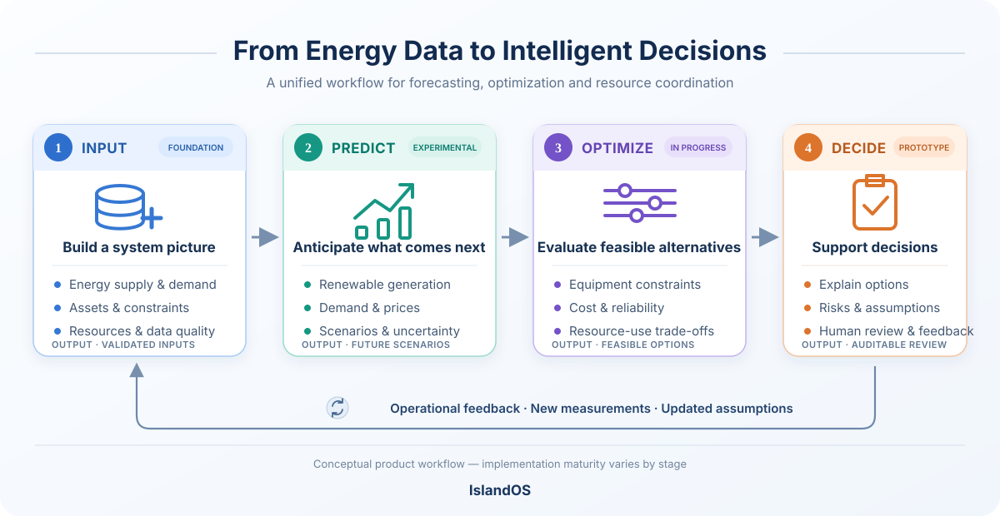

# IslandOS

<p align="center">
  <strong>From Energy Data to Intelligent Decisions.</strong><br>
  AI-assisted energy and resource coordination for energy-constrained regions and distributed infrastructure.
</p>

<p align="center">
  <a href="https://github.com/HaochuanLin/islandOS/actions/workflows/ro-tests.yml"></a>
  
  
</p>

IslandOS is an **AI-assisted, simulation-first energy and resource coordination decision-support platform** for energy-constrained regions and distributed infrastructure. It brings energy supply, demand, equipment, operating constraints, and resource requirements into a common workflow so users can examine future conditions, compare operating alternatives, and review explainable recommendations.

Here, AI refers primarily to forecasting, uncertainty analysis, and optimization. Language models may assist with interaction or explanation, but do not replace data validation, physical models, or constraint enforcement.

> **Current scope:** IslandOS is an early-stage research prototype. Its four-step workflow is the product direction; individual modules have different maturity levels. It is not a deployed plant controller, and it does not autonomously operate physical equipment.

## The four-step decision workflow

<p align="center">
  
</p>

*The core offline path from validated inputs through forecasting and constrained schedule comparison to human-reviewed decision outputs is implemented. The diagram does not imply live equipment control, production deployment, or site validation.*

1. **INPUT** — organize energy, demand, asset, resource, and constraint data.
2. **PREDICT** — validate canonical energy/price signals and compare replaceable statistical forecast candidates with rolling-origin replay. Error bands and model provenance are exposed; site-specific accuracy is not established.
3. **OPTIMIZE** — pass aligned forecasts into a bounded joint battery/diesel schedule search, compare policies and stress cases, and withhold modeled savings when service equivalence fails. The heuristic is not a guaranteed global optimum.
4. **DECIDE** — expose model provenance, hourly schedule comparisons, customer-entered economics, and downloadable decision audits. A versioned local reference API supports tenant-scoped sites and read-only telemetry; it is not a public production service.

The workflow is designed to be extensible across use cases such as remote microgrids, essential water services, storage, flexible loads, and other distributed infrastructure. These are potential application areas, not claims of validated deployments.

## Try the interactive demo

**[Open the public IslandOS demo](https://islandos.streamlit.app/)** — an interactive planning and simulation prototype.

You can explore the built-in synthetic scenario or upload hourly data, adjust selected equipment and storage assumptions, compare operating strategies, inspect hourly outcomes, and export results.

**No site data yet?** The built-in example is synthetic and intended for exploration. Uploaded data is analyzed as supplied; the app does not establish that it is accurate or representative of a real site.

## Current implementation and maturity

**Implemented on main**
- Public interactive Streamlit application with energy–water screening, price-aware flexible-load optimization, and a forecast-led joint battery/diesel decision page (synthetic or user-supplied hourly history). The joint optimizer now uses the same canonical forecast signal catalog as customer data onboarding.
- Deterministic integrated microgrid accounting baseline for selected PV, wind, battery, grid, backup, RO, and water-inventory flows.
- Rule-based strategy comparisons, hourly audit outputs, CSV/XLSX onboarding, local-first site workspace, versioned asset records, source hashes, immutable run manifests, append-only audit history, verified whole-workspace SQLite backup/restore, and a unified multi-domain forecast catalog with a replaceable candidate engine.
- Offline forecast-to-joint-resource workflow with model provenance, chronological backtests, service-equivalence-gated cost comparison, and JSON decision audit. Optional flexible-load forecasts can be scheduled jointly with battery/diesel; water-demand forecasts can be translated into reserve-constrained RO electrical demand before dispatch optimization.
- Versioned local reference API with tenant-scoped identity/site records and read-only telemetry; local SQLite only, loopback-only, no device writes.
- Local read-only telemetry gateway with versioned vendor-field/unit mappings, bounded JSON ingress, optional bearer-token protection, strict timestamp/freshness validation, and offline replay. A normalized sensor contract rejects future-dated samples and quarantines duplicate batch identities.
- Read-only Shadow Mode comparison and JSON replay with tolerance/deviation/blocked outcomes and audit digests; production configuration preflight rejects unsafe origin allowlists and always withholds operational approval. These are deployment-readiness foundations, not live hardware connectivity or production authorization.

**Experimental**
- Rolling-horizon dispatch and candidate-search workflows.
- Transparent hourly tariff-forecast baseline and price-aware linear-programming optimizer. The interactive page supports scenario CSV import, a seasonal-naive tariff forecast, and equal-energy cost comparison. This remains an experimental baseline, not a trained market model. Run the synthetic optimizer example with `python examples/price_aware_flexible_load_demo.py`.
- Forecasting baselines, replaceable plug-in interfaces, and separate model evaluation experiments.
- Forecast uncertainty and robust dispatch research, alternative optimizers, public-data/site validation, and device-vendor adapter experiments.

**Still planned / not yet established**
- Forecast accuracy validated on measured data for a named customer site, with calibrated uncertainty and transfer testing.
- A broad optimizer covering additional asset classes (for example thermal storage, pumping, process backlog and richer network constraints) with consistently propagated uncertainty.
- Production-grade managed database/object storage, TLS, secrets management, security review, backup/restore and operational monitoring.
- Customer usability evidence and verified site economics from a real decision owner.

The repository now contains a tested offline path from canonical customer history through multi-signal forecasting to joint battery/diesel schedule comparison and a local reference API. These pieces do not constitute field validation, a production SaaS deployment, or autonomous control. Experimental scripts and integrations are not automatically part of the hosted app. See [A–F final closeout ledger](docs/STAGE_ABC_CLOSEOUT.md) for the current acceptance decision and remaining gates, [Product system blueprint](docs/PRODUCT_SYSTEM_BLUEPRINT.md) for maturity definitions, and [Experiments and workflows](docs/EXPERIMENTS_AND_WORKFLOWS.md) for individual research scopes.

## Quick start

Use Python 3.10 or newer, then install the dependencies declared in `requirements.txt`.

```bash
git clone https://github.com/HaochuanLin/islandOS.git
cd islandOS
python -m venv .venv

# Windows PowerShell
.venv\Scripts\Activate.ps1

# macOS / Linux
source .venv/bin/activate

pip install -r requirements.txt
streamlit run app.py
```

The app opens in your browser. For input columns, units, and assumptions, see the [app data guide](docs/ENERGY_WATER_STRATEGY_COMPARISON.md).

## Repository structure

```text
islandOS/
├── app.py                  # Streamlit application entry point
├── islandos_core/          # Shared system and simulation logic
├── optimization/           # Optimization algorithms
├── experiments/            # Research experiments and benchmarks
├── tools/                  # Command-line utilities
├── data/                   # Example data and input templates
├── config/                 # Example configurations
├── configs/                # Additional configuration sets
├── islandos_sensors/       # Sensor and telemetry interfaces
├── pages/                  # Additional Streamlit pages
├── tests/                  # Automated tests
├── docs/                   # Architecture, guides, and evidence
├── assets/                 # Static images and diagrams
└── .github/workflows/      # Automated checks
```

Some legacy Python entry points remain in the repository root for compatibility with existing commands, imports, and deployment workflows. New reusable code should be placed in the appropriate module directory. See the [full repository map](docs/REPOSITORY_MAP.md).

## Technical documentation

| Start with | What it covers |
|---|---|
| [Product system blueprint](docs/PRODUCT_SYSTEM_BLUEPRINT.md) | Four-step product workflow, internal architecture mapping, current implementation, and maturity boundaries |
| [Repository map](docs/REPOSITORY_MAP.md) | Where code, experiments, tests, and documentation live |
| [Experiments and workflows](docs/EXPERIMENTS_AND_WORKFLOWS.md) | Runnable research commands and benchmark procedures |
| [Integrated microgrid model](docs/INTEGRATED_MICROGRID_MODEL.md) | Physical accounting assumptions and model scope |
| [Forecasting baseline](docs/SCENARIO_FORECASTING_BASELINE.md) | Current transparent forecast baseline and evaluation boundary |
| [Price-aware flexible-load scheduling](docs/PRICE_AWARE_FLEXIBLE_LOAD_SCHEDULING.md) | Experimental hourly tariff baseline, tariff-to-optimizer workflow, continuous-load LP, and limitations |
| [SIC reference migration assessment](docs/SIC_REFERENCE_MIGRATION_ASSESSMENT.md) | What was learned from the SIC repositories, what was adopted, and what is deliberately deferred |
| [Productization roadmap](docs/PRODUCTIZATION_ROADMAP.md) | Product phases, customer discovery, economics, and exit gates |
| [Phase 4 customer dashboard](docs/PHASE4_CUSTOMER_DECISION_DASHBOARD.md) | Forecast-led customer decision view and scope boundaries |
| [Phase 4 customer data onboarding](docs/PHASE4_CUSTOMER_DATA_ONBOARDING.md) | Hourly CSV schema, validation, provenance, and hosted-upload privacy |
| [Phase 4 investment economics](docs/PHASE4_CUSTOMER_INVESTMENT_ECONOMICS.md) | Customer-entered CAPEX, O&M, NPV, payback, replacement, and sensitivity screening |
| [Engineering maturity roadmap](docs/ENGINEERING_MATURITY_ROADMAP.md) | Evidence requirements and delivery gates |
| [Deployment guide](docs/DEMO_DEPLOYMENT.md) | Local deployment, health checks, and operational boundaries |

The earlier RO simulation screenshot has been retained as a historical example in [Early RO simulation demo](docs/EARLY_RO_SIMULATION_DEMO.md); it is not the product workflow diagram.

## Evidence and limitations

- Built-in demo inputs are synthetic unless explicitly identified otherwise.
- Public datasets from other locations can test data pipelines and evaluation methods; they do not establish performance at an island or customer site.
- Physical models simplify real equipment and do not include all electrical-network, protection, dynamics, or plant-safety behavior.
- Forecast scores are dataset- and time-window-specific; transfer to a new site must be tested.
- Optimization outputs are candidate comparisons under declared assumptions, not certified schedules or guaranteed savings.
- No field-proven customer savings, commercial deployment, or autonomous equipment control is claimed.

## Development and tests

Contributions are welcome. Please keep data provenance, units, assumptions, and maturity labels explicit. Compare complex models against transparent baselines and add tests for behavior changes.

Run the test suite from the repository root:

```bash
python -m pytest -q
```

Passing tests verify software behavior, not forecast accuracy, engineering feasibility, safety, or real-world benefits.

## Experimental pilot

The Nan'ao emergency desalination scenario is a bounded experimental pilot case. It is not the IslandOS product identity or the limit of its intended application scope. Its scenario assumptions are not measured site data.

## License

MIT — see [LICENSE](LICENSE).
