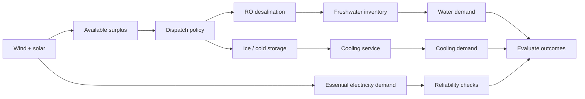
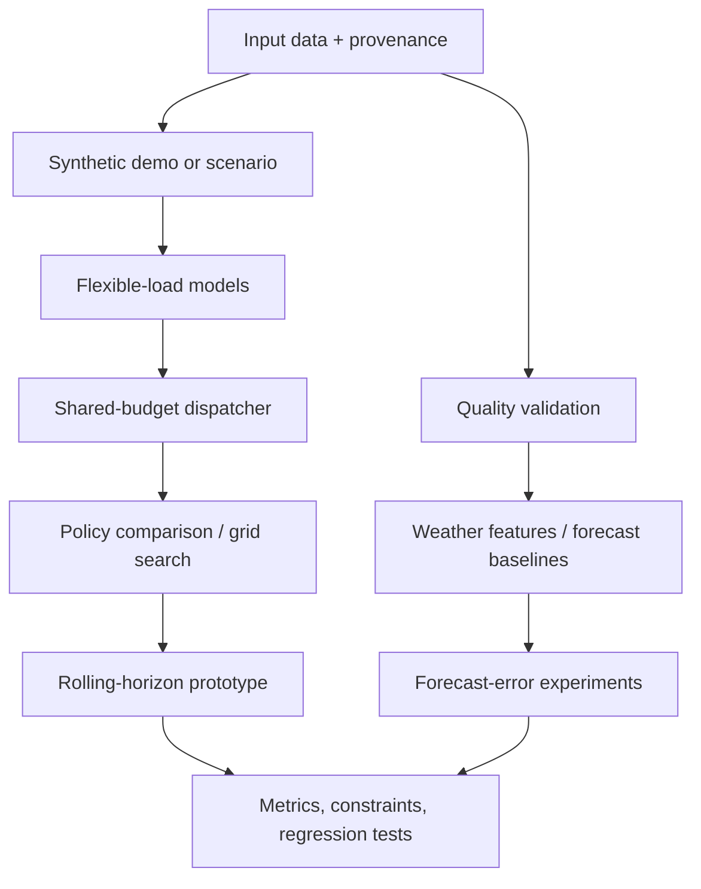
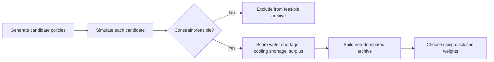

# Nan’ao-type scenario — IslandOS｜Schneider Go Green 2026 Top-12 Finalist

> **Scenario-based simulation assumption, not measured real-world data.** This branch contains a Nan’ao-type event-energy scenario for Schneider Go Green 2026 review. It is not a reconstruction of measured Nan’ao curtailment, not a grid power-flow model, and not evidence of field performance. The main branch contains a separate generic 400 kW / 3.5 kWh/m³ 24-hour demo; this branch uses a 50 kW / 4.0 kWh/m³ event-energy scenario with 1,000 Monte Carlo runs and fixed seed 20261021. Do not mix outputs from the two scenarios.

<p align="center">
  <strong>Turn renewable-energy surplus into useful island resources.</strong><br>
  A simulation-first toolkit for flexible-load dispatch, water–energy co-simulation, and forecast-aware planning research.
</p>

<p align="center">
  <a href="https://github.com/HaochuanLin/islandOS/actions/workflows/ro-tests.yml"></a>
  
  
  
</p>

IslandOS explores a practical question: **when wind and solar exceed immediate electricity demand, can a controller use part of that surplus to produce resources an island needs—without sacrificing essential services?**

The repository now contains a runnable synthetic demo, experimental flexible-load models and dispatch tools, data-quality checks, a NASA POWER weather-data adapter, and forecast-baseline evaluation scripts. It is an **early-stage software prototype**: no field deployment or validated real-island performance is claimed.

## Example visualization

<p align="center">
  
</p>

<p align="center"><em>Illustrative simulation output only; synthetic results are not field measurements or evidence of real-island performance.</em></p>

---

## At a glance

| | What is in the repository today |
|---|---|
| ⚡ **Energy dispatch** | Shared-budget, priority-based flexible-load dispatcher |
| 💧 **Water** | Experimental reverse-osmosis (RO) and freshwater-inventory model |
| ❄️ **Cooling** | Simplified ice-making / cold-storage load prototype |
| 🌦️ **Data** | NASA POWER hourly environmental-data importer and strict CSV quality gate |
| 📈 **Forecast evaluation** | Persistence and 24-hour seasonal-naive baselines with chronological holdout and multi-window evaluation |
| 🧪 **Experiments** | Policy comparisons, forecast-to-dispatch evaluation, fixed synthetic end-to-end benchmark, grid search, sensitivity audits |
| ✅ **Verification** | Unit/regression tests, deterministic fixture check, and GitHub Actions artifacts |

> **Honest status:** some components are implemented as prototypes, not integrated into one validated end-to-end controller. Forecast baselines predict a NASA POWER weather parameter—not island PV output, wind generation, or electricity demand. See the [capability matrix](#implementation-status) and [limitations](#limitations).

## The core idea

A battery stores electricity. IslandOS also investigates **shifting flexible electricity consumption in time** so surplus energy can create useful local resources.



**Physical boundary:** freshwater is stored for water supply; it is not converted back into electricity. Flexible loads can shift demand, but they do not automatically replace batteries, backup generation, or grid-forming equipment.

## How the code fits together



The diagram shows the **research workflow**, not a claim that every stage is already connected in a production pipeline. The rolling-horizon experiment uses synthetic scenarios and simple baseline/error patterns; the weather-data workflow is separate from actual island load and generation data.

## What you can run

| Goal | Command | What it demonstrates |
|---|---|---|
| Run the original 24-hour demo | `python island_microgrid_ro_sim.py` | Synthetic wind/PV/load, rule-based RO dispatch, freshwater inventory, plot output |
| Compare flexible-load policies | `python experiments/compare_dispatch_policies.py` | RO-only, cold-storage-only, and two priority orders across synthetic scenarios |
| Generate a visual experiment report + physical audit | `python experiments/generate_dispatch_report.py --output-dir build/dispatch-report` | SVG chart, CSV/JSON results, Markdown summary, and hourly `audit_report.json` |
| Inspect candidate trade-offs | `python optimization/grid_search_optimizer.py` | Small exhaustive policy search, feasibility filtering, Pareto archive, weighted recommendation |
| Run NSGA-II multi-objective search | `python optimization/nsga2_dispatch_optimizer.py` | Evolutionary search over RO/ice policy parameters; audited Pareto trade-offs across three synthetic objectives |
| Test forecast-error sensitivity | `python experiments/forecast_error_robustness.py` | How perturbed surplus forecasts affect policy selection |
| Run the rolling-horizon prototype | `python experiments/rolling_horizon_dispatch.py` | Re-plan over a short window and compare against fixed-priority baselines |
| Run equipment-parameter sensitivity | `python experiments/parameter_sensitivity.py path/to/site_hourly.csv --output build/parameter-sensitivity.json` | Compare Pareto outcomes under low/high changes to RO energy intensity, chiller COP, and storage capacities |

| Audit objective weights | `python experiments/weight_sensitivity_audit.py` | Re-score the same synthetic outcomes under alternative illustrative weights |
| Open staff data-entry form | Open `tools/site_data_entry.html` in a browser | Offline manual entry/import, basic validation, CSV + provenance sidecar export |
| Validate a time-series CSV | `python data_quality.py path/to/data.csv --source-type public` | Server-side CLI quality gate; checks schema, values, timestamp order and interval spacing |
| Download NASA POWER weather data | See [data workflow](#weather-data-and-forecast-baselines) | Saves hourly environmental parameters and provenance metadata |
| Run all regression tests | `python -m unittest discover -s tests -v` | Checks selected model invariants and edge cases |

The rolling-horizon prototype carries the RO minimum-run commitment between hourly replans and reports a violation if a committed hour lacks enough renewable power. Before a new start, it now checks realized power remaining after higher-priority loads; if the RO cannot receive rated power, the start is deferred and recorded in the hourly audit (`ro_start_deferred_for_power`, `ro_available_power_after_priority_kw`). This prevents avoidable starts under a known current-hour power shortfall, but it does not cancel an already-running commitment. Its JSON result now includes `hourly_audit` (actual and forecast surplus, chosen priority, RO activity/power, remaining commitment, inventory states, and violation count) plus `constraint_violation_hour_indices` so forecast-error failures can be located rather than hidden in an aggregate. Each RO audit row labels `ro_operating_state` as `OFF`, `RUNNING`, `RUNNING_WITH_BACKUP`, `COMMITMENT_POWER_SHORTFALL`, or `RECOVERY_LOCKOUT`. A no-backup power shortfall records zero actual power use and zero production while raising a constraint violation; `ro_active` means energized, not merely committed. The default prototype then enforces one simulated hour of recovery lockout before another start and carries that counter across hourly replans. This is an explicit simplified restart policy, not a validated plant trip/restart controller: real interlocks, fault diagnosis, startup/ramp dynamics, and site-specific restart criteria remain out of scope.

### Quick start

Python **3.10 or newer is recommended**; CI is currently tested on Python 3.11. Older versions are not covered by CI.

```bash
git clone https://github.com/HaochuanLin/islandOS.git
cd islandOS
python -m venv .venv

# Windows PowerShell
.venv\Scripts\Activate.ps1

# macOS / Linux (use this instead of the Windows command)
source .venv/bin/activate

pip install -r requirements.txt
python island_microgrid_ro_sim.py
```

The original demo uses synthetic inputs and writes a plot named `island_microgrid_ro.png`.

### Reproducible dispatch report

The report generator reruns the same 3 synthetic scenarios × 4 dispatch policies used by the comparison experiment. It produces:

- `REPORT.md` — compact results table and interpretation limits
- `dispatch_comparison.svg` — grouped charts for remaining surplus, unmet water demand, and unmet cooling demand
- `results.csv` and `results.json` — machine-readable outputs

The GitHub Actions workflow runs regression tests, generates the reports, and uploads the files as the `islandos-dispatch-report` artifact (retained for 30 days). It also runs a fixed-seed NSGA-II-versus-exhaustive Pareto benchmark and uploads `islandos-pareto-benchmark` (also retained for 30 days). The audit verifies internal accounting and configured bounds only; it is not proof of plant safety, site-specific feasibility, or model accuracy. Open [the latest workflow run](https://github.com/HaochuanLin/islandOS/actions/workflows/ro-tests.yml) and download the artifact after a successful run. These results are synthetic and must not be presented as field measurements.

To run the regression suite:

```bash
python -m unittest discover -s tests -v
```

### End-to-end forecast-to-dispatch benchmark

Run the fixed 168-hour synthetic benchmark from input CSV through forecast metrics and dispatch-policy comparisons:

```bash
python experiments/generate_synthetic_dispatch_benchmark.py --check
python experiments/evaluate_forecast_dispatch.py \
  data/examples/synthetic_dispatch_benchmark.csv \
  --output build/forecast-dispatch-benchmark/results.json
```

The input fixture and deterministic generator are committed under `data/examples/` and `experiments/`. The report compares the supplied forecast against persistence and evaluates rolling dispatch, fixed RO-first / ice-first policies, and a perfect-information hindsight reference. The rolling planner and fixed-policy comparison now prioritize fewer constraint-violation hours before the illustrative service score; reports retain both violation-hour counts and total violation flags. GitHub Actions runs the same check and uploads `islandos-forecast-dispatch-benchmark`.

**Interpretation boundary:** this is an integration and regression benchmark using synthetic data. Its score weights are illustrative; the hindsight policy is not deployable; demands are treated as known; and the model does not represent full island-grid physics. The benchmark can show that the pipeline runs reproducibly, but it cannot prove real-island performance or that rolling dispatch is universally better. See [the benchmark protocol](docs/END_TO_END_BENCHMARK.md) and [the input provenance note](data/examples/README.md).

## The optimization loop (prototype)



The grid-search baseline exhaustively searches a small policy space (two priority orders × four RO minimum-run durations). The separate NSGA-II prototype evolves candidates across priority, RO minimum-run duration, RO start threshold, RO rated power, and chiller rated power. The site-data workflow can optionally add annualized lifecycle cost as a fourth objective when the required cost inputs and complete annual data are available. Neither optimizer covers every possible hourly setpoint, and results remain conditional on simplified physics and supplied inputs.

### Benchmark NSGA-II against exact search

For the finite configured policy space, compare evolutionary search with an exhaustive Pareto reference:

```bash
python experiments/benchmark_nsga2_vs_exhaustive.py --scenario steady_surplus --output build/pareto-benchmark.json
```

The benchmark reports exact-front recall and NSGA-II-front precision by candidate genome, along with evaluated candidate counts and the exact Pareto genomes. The exhaustive run is protected by a 100,000-candidate default safety limit (use the `--max-candidates` option to override). These metrics measure search coverage within the configured finite space only; they do not validate the simulator's physics or imply real-site performance. See [the Pareto benchmark guide](docs/PARETO_BENCHMARK.md).

### Experimental NSGA-II optimizer

Run `python optimization/nsga2_dispatch_optimizer.py --json` to evolve candidate policies with NSGA-II (non-dominated sorting, crowding distance, and tournament selection). It minimizes unmet water demand, unmet cooling demand, and remaining renewable surplus while filtering candidates through the independent dispatch audit. The default run is deterministic (`--seed 20261021`) and reports how many unique candidates were evaluated.

The optional fourth objective, `annualized_lifecycle_cost_per_year`, activates only when all declared cost fields are supplied and the input is a complete calendar year (8760 hourly rows, or 8784 in a leap year). The cost estimate includes annualized RO/chiller CAPEX, fixed O&M, RO variable O&M, and the configured marginal/opportunity cost of flexible-load renewable electricity. It fails closed on short horizons and on backup-power mode, whose costs are not yet modeled. See [the parameter and cost-model documentation](docs/PARAMETER_CONFIGURATION.md) for assumptions and exclusions.

This is a multi-objective evolutionary-search prototype, **not a trained AI model** and not optimization of arbitrary hourly controls. Costs are not needed for the three-objective Pareto front; if complete cost inputs are supplied to the site-data workflow, cost becomes a fourth objective. Results are conditional on the simplified simulator and supplied data, not validated real-island performance.

### Bring your own site data

**No real-island dataset is bundled or assumed.** If staff can provide measurements later, open [`tools/site_data_entry.html`](tools/site_data_entry.html) in a browser (it works as a local/offline form), enter the site and provenance details, add hourly rows or import an existing CSV, run the basic checks, then download the CSV and metadata JSON. The form does not upload data, invent missing values, or run dispatch. Keep the metadata JSON alongside the CSV.


### Sensor adapter contract (hardware-ready interface, not live integration)

IslandOS now defines a versioned normalized telemetry contract and mock source in [`islandos_sensors/`](islandos_sensors/), with a [hardware adapter contract](docs/SENSOR_ADAPTER_CONTRACT.md) and [quickstart](docs/SENSOR_ADAPTER_QUICKSTART.md). Messages include site/device/signal IDs, timestamp with timezone, numeric value, unit, quality, source type, and a raw-source reference. The validator rejects missing metadata, unsupported signals/units, stale samples, non-finite values, and non-good quality.

**Important:** no physical sensor connection is implemented. The mock messages are explicitly synthetic. Real hardware still needs a device-specific read-only adapter configured and tested against the actual model/protocol/register map/API, scaling, calibration, and timestamp behavior. This contract does not authorize live control.

### Site readiness gate: live-like telemetry and manual CAPEX

Use the offline [staff readiness form](tools/site_readiness_form.html) to enter a timestamped telemetry snapshot, static equipment parameters, and (for economic mode) staff-sourced CAPEX/O&M. A separate [site-readiness guide](docs/SITE_READINESS_GATE.md) defines a fail-closed input gate before site-specific offline scenarios. It requires timestamped wind/PV output, critical load, current usable reservoir inventory, reservoir capacity, and RO equipment parameters. Stale telemetry, missing values, invalid numbers, or water inventory above usable capacity block the requested run. Copy [the readiness template](config/site_readiness.example.json) to a private local file and run:

```bash
python site_readiness.py path/to/site_readiness.json --mode dispatch --json
python site_readiness.py path/to/site_readiness.json --mode economic --json\npython experiments/run_site_scenario.py path/to/site_readiness.json path/to/site_hourly.csv --source-type measured --output-dir build/site-optimization
```

CAPEX and annual O&M are **staff-entered inputs**, not inferred by IslandOS; economic mode blocks until the required cost fields and a traceable source reference are present. Today the gate reads a staff-prepared JSON snapshot or sensor export: **no live sensor connection is implemented**. Use `experiments/run_site_scenario.py` to enforce the gate before the existing offline optimizer; the hourly CSV is independently quality-checked as well. Passing the gate only means input completeness/basic plausibility checks passed. It never starts equipment or authorizes live control.

The form exports the same schema as [`data/templates/site_hourly_input_template.csv`](data/templates/site_hourly_input_template.csv). Alternatively, edit that template directly. Add one row per interval and provide data in the documented units. The input columns are:

- `timestamp`: ISO-8601 timestamp with timezone, such as `2026-01-01T00:00:00Z`
- `wind_kw`, `pv_kw`: average wind and solar power during the hour, in kW
- `critical_load_kw`: average essential electricity demand during the hour, in kW
- `water_demand_m3`: freshwater demand during that hourly interval, in m³
- `cooling_demand_kw_th`: cooling demand during the hour, in kW thermal

Run the end-to-end input pipeline:

```bash
python experiments/run_nsga2_from_csv.py path/to/site_hourly.csv \
  --source-type measured \
  --output-dir build/site-optimization
```

Use `--source-type public`, `synthetic`, or `forecast` when appropriate. The runner checks required columns, finite non-negative values, timezone-aware timestamps, strict hourly spacing, and duplicate/out-of-order records. It does not impute, interpolate, or silently repair missing data. It calculates available surplus as `max(wind_kw + pv_kw - critical_load_kw, 0)`.

Outputs: `nsga2_results.json` (input-quality report, data summary, algorithm settings, Pareto solutions and limitations) and `pareto_front.csv` (one row per candidate policy and its objective values). The default behavior stops if essential electricity demand is unmet in any hour. `--allow-critical-shortfall` permits exploratory execution but only reports that deficit; it does **not** optimize backup power or essential-service reliability.

**Important:** the cost objective is a first-pass annualized estimate, not a bankable techno-economic assessment. It requires a full calendar-year input and complete economic fields, and currently omits replacements, taxes, financing, backup-generation costs, emissions, demand charges, and unmet-service penalties. Battery dispatch, forecast uncertainty, and plant safety constraints are not integrated. The model reports candidate trade-offs—not a guaranteed operating schedule. Keep raw data provenance and units with the submitted CSV.

## Forecast-to-dispatch evaluation

A separate evaluator accepts a **paired hourly forecast and realization** and compares forecast-driven rolling dispatch with fixed-priority policies on the same realized profile. This is a dispatch-interface evaluation; it does not turn the weather-parameter model into a renewable-power forecast.

```bash
python experiments/evaluate_forecast_dispatch.py path/to/paired_hourly.csv \
  --output build/forecast-dispatch-evaluation.json
```

The CSV schema, units, timestamp requirements, metrics, interpretation rules, and limitations are documented in [the forecast-to-dispatch guide](docs/FORECAST_DISPATCH_EVALUATION.md).

For longer traces, evaluate independent chronological windows and inspect whether results are consistent across periods:

```bash
python experiments/evaluate_forecast_dispatch_windows.py path/to/paired_hourly.csv \
  --window-hours 168 \
  --output build/forecast-dispatch-windows.json
```

This reports per-window metrics and aggregate persistence skill. Windows reset storage to the same default initial state, so this is a repeated-window robustness check, not a continuous island simulation. For a state-continuous full-trace backtest that carries water and thermal inventories forward each hour, run `python experiments/evaluate_forecast_dispatch_continuous.py path/to/paired_hourly.csv --output build/forecast-dispatch-continuous.json`. Its persistence baseline shares the first-hour forecast as a warm-up and uses only the previous observed surplus thereafter; forecast metrics exclude that warm-up hour. See [the continuous backtest guide](docs/CONTINUOUS_FORECAST_DISPATCH_BACKTEST.md). Inputs must provide timestamp-aligned actual surplus and forecast surplus in kW, water demand in m³ per hour, and cooling demand in kW thermal. The evaluator rejects missing values, negative values, timezone-naive timestamps, and hourly gaps instead of silently repairing them.

The report includes forecast MAE/RMSE/bias, unmet water and cooling demand, remaining surplus, constraint violations, and the score difference against the best fixed-priority policy. When at least two rows are available, it also compares the supplied forecast against a one-step persistence baseline on the same aligned time window, and reruns dispatch for both forecasts with identical realized surplus, demands, and initial inventories. Positive forecast skill means lower MAE/RMSE than persistence; the dispatch score difference is case-specific, not proof of general superiority. The perfect-information policy is only a hindsight reference. Label input provenance accurately; synthetic or unverified data are not field evidence.

## Weather data and forecast baselines

IslandOS includes a NASA POWER hourly importer for `ALLSKY_SFC_SW_DWN`, `T2M`, and `WS10M`, with a provenance sidecar. Example:

```bash
python data_sources/nasa_power_hourly.py \
  --latitude -35.2 --longitude -63.5 \
  --start 20200101 --end 20200107 \
  --output data/raw/nasa_power_hourly.csv
```

The coordinates and dates above are examples only. Consult the [NASA POWER hourly API documentation](https://power.larc.nasa.gov/docs/services/api/temporal/hourly/) and verify the units reported in the downloaded metadata.

Prepare environmental features:

```bash
python data_sources/prepare_environmental_features.py \
  data/raw/nasa_power_hourly.csv \
  --output data/processed/nasa_environmental_features.csv
```

Evaluate simple one-hour-ahead weather-parameter baselines:

```bash
python experiments/forecasting_baselines.py \
  data/raw/nasa_power_hourly.csv \
  --output data/processed/forecast_baselines.csv
```

The first script compares persistence with a 24-hour seasonal-naive baseline using chronological holdout and multiple chronological test windows. It reports MAE, RMSE and bias with output metadata. To add a small trained model, run:

```bash
python experiments/train_weather_forecaster.py \
  data/processed/forecast_baselines.csv \
  --output data/processed/trained_weather_forecast.csv
```

The trained model is ordinary least-squares regression using cyclical timestamp features and 1-, 3-, and 24-hour lags. It fits only on the chronological history partition and compares its holdout MAE/RMSE/bias against both simple baselines. The first 24 rows are omitted again because the exported baseline CSV begins after its own 24-hour warm-up. Positive `mae_skill_vs_best_baseline` means lower holdout MAE than the best simple baseline; a negative value means it performed worse. This is a **trained weather-parameter prototype**, not an island energy forecast or evidence of operational benefit. It does not generate missing PV/wind output or demand data.

## Editable equipment and economic parameters

Copy [`config/site_parameters.example.json`](config/site_parameters.example.json) and pass it to the site-data runner:

```bash
python experiments/run_nsga2_from_csv.py path/to/site_hourly.csv \
  --config config/site_parameters.example.json \
  --source-type measured \
  --output-dir build/site-optimization
```

The JSON configuration controls RO specific energy and reservoir assumptions, chiller COP and thermal-storage assumptions, and the discrete NSGA-II search ranges. Unknown economic values (electricity price, capital cost, O&M, analysis horizon and discount rate) can remain `null`. The result JSON records the applied equipment/search configuration and lists missing economic fields.

**Cost-objective status:** when every required economic field is supplied, the site-data optimizer adds annualized lifecycle cost as a fourth Pareto objective, but only for a complete calendar-year CSV. Partial-year inputs are rejected for cost optimization; backup-generation cost is not yet modeled. This is a first-pass estimate with documented exclusions, not a bankable techno-economic assessment. The example equipment values are illustrative defaults, not vendor data or measurements. Document the source, date and uncertainty of every real-site assumption. See [parameter configuration guide](docs/PARAMETER_CONFIGURATION.md).

## Implementation status

| Capability | Status | What the status means |
|---|---|---|
| Synthetic 24-hour RO demo | **Implemented** | Runnable demonstration with simplified physics |
| Freshwater reservoir balance | **Implemented / simplified** | Inventory accounting, not a site-calibrated plant model |
| RO and cold-storage plug-ins | **Experimental** | Tested interfaces and simplified component models |
| Shared-budget dispatcher | **Experimental** | Sequential allocation in explicit priority order |
| Grid-search / Pareto policy selection | **Experimental** | Small candidate space and illustrative objective weights |
| NASA POWER importer + provenance | **Implemented** | Environmental data only; not island generation or demand |
| CSV quality gate and feature preparation | **Implemented** | Structural checks and lag features; no automatic imputation |
| Staff data-entry window | **Implemented prototype** | Local browser form for manual entry/import and CSV + metadata export; no server, authentication, or dispatch integration |
| Persistence / seasonal-naive evaluation | **Implemented baseline** | Chronological evaluation of a weather parameter |
| Trained weather-parameter regression | **Experimental** | Least-squares model, lag/time features and chronological holdout; not connected to dispatch |
| Integrated, trained forecast-and-dispatch AI | **Not yet implemented** | Requires validated renewable/load targets, forecast-aware dispatch integration and end-to-end evaluation |
| Site economics, lifecycle emissions and field validation | **Not available** | Requires real data, engineering assumptions and external validation |

## Metrics that matter

| Metric | Why track it? |
|---|---|
| Renewable surplus remaining / curtailment (kWh) | Measures unused energy in the modelled boundary |
| Essential electricity not served (kWh) | Prevents “better utilization” from hiding reliability losses |
| Freshwater produced and unmet demand (m³) | Measures water-service outcomes |
| Cooling served and unmet demand (kWhₜₕ) | Measures the cold-storage service trade-off |
| Backup energy and constraint violations | Exposes infeasibility rather than hiding it |
| Forecast MAE, RMSE and bias | Tests whether a forecast beats transparent baselines |
| Operating cost / emissions | Add only when source data and calculation boundaries are defined |

Reducing surplus is not automatically a win if water or cooling demand goes unmet, essential power becomes unreliable, or equipment constraints are violated.

## Limitations

- All dispatch and policy-comparison scenarios currently use synthetic profiles; NASA POWER data are environmental covariates, not measured island load or generation.
- Some experiments are separate prototypes rather than one end-to-end integrated system.
- The dispatcher uses explicit priority order; it does not jointly optimize all hourly decisions.
- The optimizer explores a small candidate space and uses illustrative objective weights that have not been validated by island operators.
- The RO model omits important plant effects such as membrane fouling, flushing, ageing and detailed variable-load behaviour.
- The cold-storage model omits thermal leakage, detailed refrigeration dynamics and site-specific operating constraints.
- A complete island electrical model with diesel generation, battery dynamics, network constraints and protection systems is not implemented.
- Cost, emissions reductions, battery-life extension and real-world resilience benefits have not been quantified.

## Repository map

| Path | Purpose |
|---|---|
| `island_microgrid_ro_sim.py` | Original synthetic RO demo |
| `flexible_loads.py` | Experimental RO and cold-storage models |
| `dispatch_engine.py` | Shared-budget priority dispatcher |
| `optimization/grid_search_optimizer.py` | Candidate search and Pareto-based recommendation |
| `experiments/` | Reproducible synthetic policy and forecast experiments |
| `experiments/parameter_sensitivity.py` | One-factor-at-a-time equipment-assumption sensitivity experiment |
| `data_quality.py` | Strict CSV time-series validation |
| `data_sources/` | NASA POWER import and environmental feature preparation |
| `tests/` | Unit and regression tests |
| `docs/AI_ARCHITECTURE.md` | Design boundaries, workflow and development principles |

## Development principles

1. Make assumptions and data provenance explicit.
2. Preserve essential-service and equipment constraints.
3. Compare new strategies against transparent baselines.
4. Test physical/accounting invariants and edge cases.
5. Separate measured, public, forecast and synthetic data.
6. Do not describe an experimental prototype as a deployed or validated AI system.

## License

MIT — see [LICENSE](LICENSE).


## Nan'ao-type event-energy scenario (Schneider Go Green 2026)

A dedicated, reproducible scenario is available on the `nan-ao-scenario-pilot` branch. It is deliberately separate from the original 24-hour synthetic isolated-island demo above; do not mix their outputs.

Run:

```bash
python nan_ao_scenario.py --runs 1000 --seed 20261021 --output-dir outputs/nan_ao
python -m unittest discover -s tests -v
```

The scenario writes annual-run CSV, percentile CSV, and a JSON report containing assumptions and limitations. It models assumed export-limitation events as an event-energy abstraction; it is **not** a grid power-flow model and uses no measured Nan'ao curtailment time series. Report all output as **“Scenario-based simulation assumption, not measured real-world data.”** The detailed protocol and equipment boundary are in [docs/NAN_AO_SCENARIO.md](docs/NAN_AO_SCENARIO.md).

Equipment boundary: no publicly accessible official documentation reviewed by the team confirms an operable standby seawater RO unit on Nan'ao main island. The pilot assumes a modular 50 kW RO unit would be procured, installed and owned by the local water authority, subject to site verification, approval and budget. No savings, ROI, emissions or avoided outages are claimed.


### Scenario output summary (seed 20261021; 1,000 Monte Carlo runs)

The committed result snapshot is available at:
- [JSON summary](outputs/nan_ao_summary_seed_20261021.json)
- [Percentile CSV](outputs/nan_ao_percentiles_seed_20261021.csv)

| Metric | Scenario result |
|---|---:|
| P5 annual water yield | 237.609 m³/year |
| Median annual water yield | 442.734 m³/year |
| Mean annual water yield | 447.814 m³/year |
| P95 annual water yield | 693.160 m³/year |
| P5–P95 usable RO energy | 0.950–2.773 MWh/year |

These are scenario outputs from the explicit assumed event distributions, not measurements, a forecast, or a validated field-performance range. The model is not a grid power-flow simulation. The full 1,000-row run log is retained as a GitHub Actions artifact for the workflow run; regenerate it locally with the command above.


## Interactive competition demo (synthetic 24-hour simulation)

On the `nan-ao-scenario-pilot` branch, install the dependencies and launch the dashboard:

```bash
python -m pip install -r requirements.txt
streamlit run app.py
```

The dashboard lets reviewers vary synthetic wind, solar and essential-load conditions, along with RO rated power, specific energy use, minimum run duration, reservoir capacity, and backup-power mode. It plots the resulting energy and water traces and surfaces minimum-run checks.

**Important:** this is a user interface for the existing simplified 24-hour simulator, not a validated real-island digital twin. It uses generated example inputs and a perfect-look-ahead dispatch heuristic. It omits real grid power-flow constraints, forecast errors in the UI's base run, membrane flushing, water-quality approval, and site-specific plant interlocks. All results must be described as illustrative simulation outputs.

See [the seven-day competition sprint plan](docs/COMPETITION_SPRINT.md) for the validation and submission checklist.


For publishing a reviewer-accessible public demo, follow [the deployment guide](docs/DEMO_DEPLOYMENT.md). Hosting requires a team member to connect the repository and verify the live app; the repository does not itself imply that a public web app is already deployed.


> **Branch scope:** This branch is dedicated for Schneider Go-Green 2026 review. For the general-purpose IslandOS demo, please switch back to the [main branch](https://github.com/HaochuanLin/islandOS/tree/main). For the scenario assumptions and limitations, see [docs/NAN_AO_SCENARIO.md](docs/NAN_AO_SCENARIO.md).
