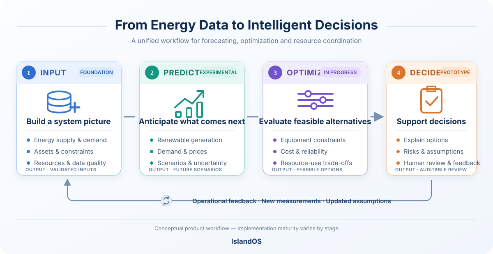

# IslandOS

<p align="center">
  <strong>From Energy Data to Intelligent Decisions.</strong><br>
  AI-assisted energy and resource coordination for energy-constrained regions and distributed infrastructure.
</p>

<p align="center">
  <a href="https://github.com/HaochuanLin/islandOS/actions/workflows/ro-tests.yml"></a>
  
  
</p>

IslandOS is a modular, **simulation-first decision-support platform**. It brings energy supply, demand, equipment, operating constraints, and resource requirements into a common workflow so users can examine future conditions, compare operating alternatives, and review explainable recommendations.

> **Current scope:** IslandOS is an early-stage research prototype. Its four-step workflow is the product direction; individual modules have different maturity levels. It is not a deployed plant controller, and it does not autonomously operate physical equipment.

## The four-step decision workflow

<p align="center">
  
</p>

1. **INPUT** — organize energy, demand, asset, resource, and constraint data.
2. **PREDICT** — estimate how selected supply, demand, or system signals may change. Current forecasting work includes baselines and separate model experiments; site accuracy is not established.
3. **OPTIMIZE** — evaluate candidate operating strategies against declared constraints and objectives. Current work includes rule-based screening and experimental search; results are not guaranteed global optima.
4. **DECIDE** — present outcomes, trade-offs, and audit information to support human review. Live actuation and autonomous control are not available.

The workflow is designed to be extensible across use cases such as remote microgrids, essential water services, storage, flexible loads, and other distributed infrastructure. These are potential application areas, not claims of validated deployments.

## Try the interactive demo

**[Open the public IslandOS demo](https://islandos.streamlit.app/)** — an interactive planning and simulation prototype.

You can explore the built-in synthetic scenario or upload hourly data, adjust selected equipment and storage assumptions, compare operating strategies, inspect hourly outcomes, and export results.

**No site data yet?** The built-in example is synthetic and intended for exploration. Uploaded data is analyzed as supplied; the app does not establish that it is accurate or representative of a real site.

## What is implemented today

- Interactive Streamlit application for energy–water strategy screening.
- Deterministic integrated microgrid simulation baseline covering selected PV, wind, battery, grid, backup, RO, and water-inventory accounting.
- Rule-based dispatch comparisons and hourly audit outputs.
- Experimental rolling-horizon and candidate-search workflows.
- Forecasting baselines, plug-in interfaces, and separate model evaluation experiments.
- CSV input validation, selected data-import workflows, and reproducible synthetic benchmarks.

These capabilities do not yet form a validated, fully forecast-driven end-to-end decision system. Forecasting, optimization, and telemetry experiments have distinct scopes; see [Methods and maturity](docs/PRODUCT_SYSTEM_BLUEPRINT.md) and [Experiments and workflows](docs/EXPERIMENTS_AND_WORKFLOWS.md).

## Quick start

Use a Python version supported by the repository dependencies; install the pinned requirements below.

```bash
git clone https://github.com/HaochuanLin/islandOS.git
cd islandOS
python -m venv .venv

# Windows PowerShell
.venv\Scripts\Activate.ps1

# macOS / Linux
source .venv/bin/activate

pip install -r requirements.txt
streamlit run app.py
```

The app opens in your browser. For input columns, units, and assumptions, see the [app data guide](docs/ENERGY_WATER_STRATEGY_COMPARISON.md).

## Repository structure

```text
islandOS/
├── app.py                  # Streamlit application entry point
├── islandos_core/          # Shared system and simulation logic
├── optimization/           # Optimization algorithms
├── experiments/             # Research experiments and benchmarks
├── tools/                  # Command-line utilities
├── data/                   # Example data and input templates
├── config/  configs/       # Example configurations
├── islandos_sensors/       # Sensor and telemetry interfaces
├── pages/                  # Additional Streamlit pages
├── tests/                  # Automated tests
├── docs/                   # Architecture, guides, and evidence
├── assets/                 # Static images and diagrams
└── .github/workflows/      # Automated checks
```

Some legacy Python entry points remain in the repository root for compatibility with existing commands, imports, and deployment workflows. New reusable code should be placed in the appropriate module directory. See the [full repository map](docs/REPOSITORY_MAP.md).

## Technical documentation

| Start with | What it covers |
|---|---|
| [Product system blueprint](docs/PRODUCT_SYSTEM_BLUEPRINT.md) | Four-step product workflow, internal architecture mapping, current implementation, and maturity boundaries |
| [Repository map](docs/REPOSITORY_MAP.md) | Where code, experiments, tests, and documentation live |
| [Experiments and workflows](docs/EXPERIMENTS_AND_WORKFLOWS.md) | Runnable research commands and benchmark procedures |
| [Integrated microgrid model](docs/INTEGRATED_MICROGRID_MODEL.md) | Physical accounting assumptions and model scope |
| [Forecasting baseline](docs/SCENARIO_FORECASTING_BASELINE.md) | Current transparent forecast baseline and evaluation boundary |
| [Productization roadmap](docs/PRODUCTIZATION_ROADMAP.md) | Product phases, customer discovery, economics, and exit gates |
| [Engineering maturity roadmap](docs/ENGINEERING_MATURITY_ROADMAP.md) | Evidence requirements and delivery gates |
| [Deployment guide](docs/DEMO_DEPLOYMENT.md) | Local deployment, health checks, and operational boundaries |

The earlier RO simulation screenshot has been retained as a historical example in [Early RO simulation demo](docs/EARLY_RO_SIMULATION_DEMO.md); it is not the product workflow diagram.

## Evidence and limitations

- Built-in demo inputs are synthetic unless explicitly identified otherwise.
- Public datasets from other locations can test data pipelines and evaluation methods; they do not establish performance at an island or customer site.
- Physical models simplify real equipment and do not include all electrical-network, protection, dynamics, or plant-safety behavior.
- Forecast scores are dataset- and time-window-specific; transfer to a new site must be tested.
- Optimization outputs are candidate comparisons under declared assumptions, not certified schedules or guaranteed savings.
- No field-proven customer savings, commercial deployment, or autonomous equipment control is claimed.

## Development and tests

Contributions are welcome. Please keep data provenance, units, assumptions, and maturity labels explicit. Compare complex models against transparent baselines and add tests for behavior changes.

Run the test suite from the repository root:

```bash
python -m pytest -q
```

Passing tests verify software behavior, not forecast accuracy, engineering feasibility, safety, or real-world benefits.

## Experimental pilot

The Nan'ao emergency desalination scenario is a bounded experimental pilot case. It is not the IslandOS product identity or the limit of its intended application scope. Its scenario assumptions are not measured site data.

## License

MIT — see [LICENSE](LICENSE).
