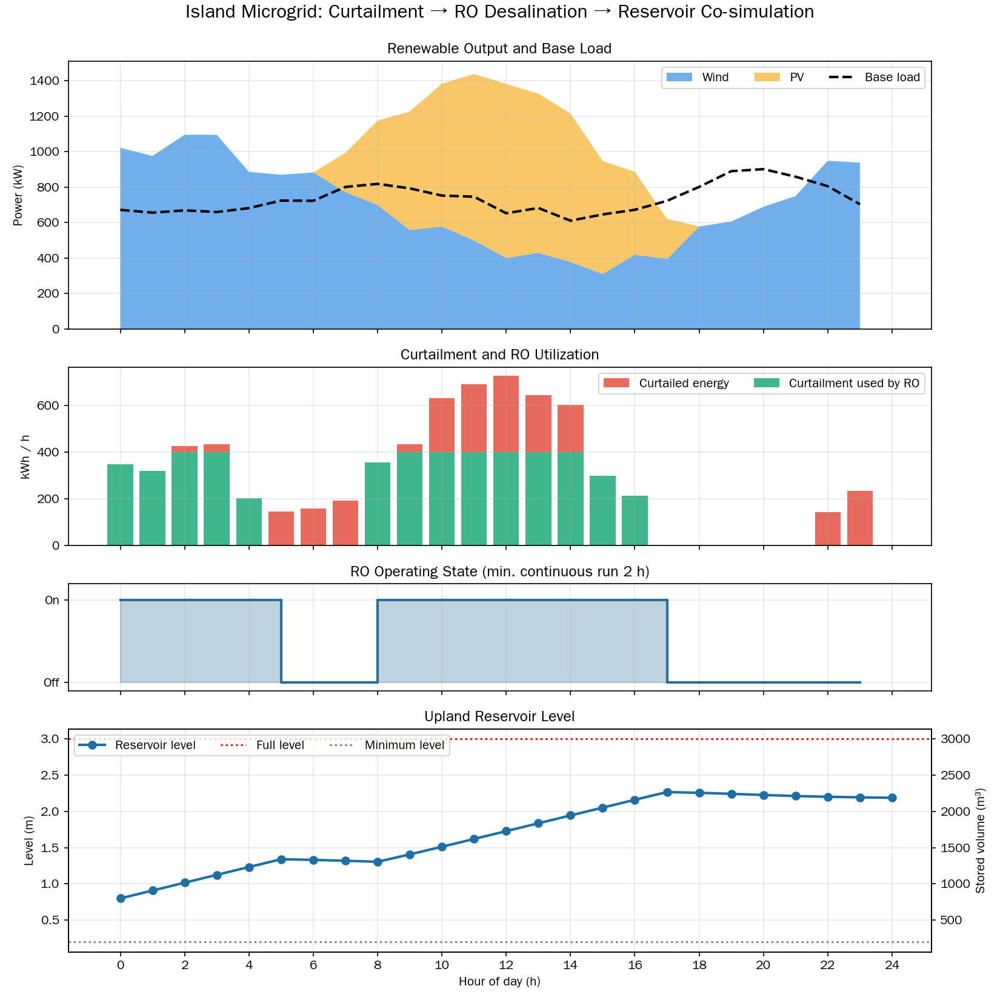

# IslandOS: Predictive Multi-Resource Optimization for Distributed Infrastructure

<p align="center">
  <strong>A modular, simulation-first decision platform for energy-constrained regions and distributed infrastructure.</strong><br>
  IslandOS is designed to connect renewable generation, storage, grid and backup supply, essential demand, flexible loads, and resource inventories in one predictive optimization workflow.
</p>

<p align="center">
  <a href="https://github.com/HaochuanLin/islandOS/actions/workflows/ro-tests.yml"></a>
  
  
</p>

**islandOS is an early-stage research prototype, not a deployed island control system.** Its product architecture is designed to be plug-in: normalized data adapters, site configuration, forecast reports, and decision policies can be replaced at documented boundaries without rewriting the dispatch core. It helps users explore when flexible loads—such as reverse-osmosis (RO) desalination and cold storage—might use renewable surplus while tracking water service, energy use, and simplified equipment constraints. Site-specific signal mapping, units, safety limits, and validation are still required; this is not yet a universal drop-in plant controller.

Use the interactive app to explore energy–water dispatch strategies, adjust RO and storage assumptions, compare water and energy outcomes, and export results. You can start with the built-in synthetic example or upload an hourly CSV for your own scenario. The built-in example is illustrative, not measured island data; uploaded data is analyzed as supplied. IslandOS is a planning and simulation prototype, not a live island control system.


<p align="center">
  
</p>
<p align="center"><em>Illustrative synthetic simulation only—not field measurements or evidence of real-island performance.</em></p>

## Experimental pilot scenario

Experimental pilot scenario: Nan’ao emergency desalination case. This is a bounded demonstration scenario, not the IslandOS product identity or technical boundary. Its assumptions are scenario inputs, not measured site data. The generic app and integrated microgrid model are designed independently of this pilot.

## Integrated system model

- **Forecast-to-screening microgrid baseline:** the interactive Microgrid screening page creates a 168-hour synthetic history, applies a seasonal-naive forecast to PV, wind, essential load, and water demand, and passes those forecast series into the common physical model. It also reports chronological replay errors on synthetic history. This is a transparent benchmark, not a trained model or site-accuracy claim; see [Scenario Forecasting Baseline](docs/SCENARIO_FORECASTING_BASELINE.md).
- **Integrated microgrid energy–water accounting:** `islandos_core/microgrid_model.py` evaluates PV, wind, essential electricity demand, battery SOC, grid imports, diesel backup, scheduled RO demand, renewable curtailment, water production, and tank inventory in one deterministic time-step simulation. It enforces explicit energy and water balances and reports unmet essential load and unmet water demand. This is a transparent priority-policy baseline—not an optimizer or validated digital twin. See [Integrated Microgrid Model](docs/INTEGRATED_MICROGRID_MODEL.md).
- **Common-physics schedule screening:** generate three transparent RO request baselines (off, 50% renewable-surplus-following, and full renewable-surplus-following), replay each through the same integrated energy–water simulator, and rank service feasibility before cost/emissions/curtailment. Export a reproducible CSV/JSON comparison with `python tools/run_schedule_screening_demo.py --hours 168 --seed 20261105`. These are rule-based candidate baselines, not a global optimizer or forecast; see [Common-Physics Schedule Evaluation](docs/COMMON_PHYSICS_SCHEDULE_EVALUATION.md).
- **Stress-tested decision screening and operating economics:** replay the same candidate schedules under nominal conditions, renewable shortfall, demand growth, energy-price increases, grid outage, and combined stress. The app reports worst-case service/cost/emissions, scenario-level downloadable audit rows, whole-system operating cost per m³ served, and incremental cost per additional m³ versus the no-RO reference. These are deterministic sensitivity and accounting indicators—not probability-calibrated reliability, equipment payback, or verified savings; see [Common-Physics Schedule Evaluation](docs/COMMON_PHYSICS_SCHEDULE_EVALUATION.md).
- **Reproducible system-level benchmark:** run `python tools/run_integrated_microgrid_demo.py --hours 168 --seed 20261104` to compare a no-RO baseline with a renewable-only RO flexible-load policy on the same synthetic scenario. It exports a provenance-labelled JSON report and hourly CSV; see [Integrated Microgrid Demo](docs/INTEGRATED_MICROGRID_DEMO.md).

## Product architecture: Streamlit lab, shared core, future desktop app

**Streamlit is IslandOS's rapid product laboratory, not the long-term software boundary.** It is used to test onboarding flows, data-quality feedback, asset configuration, scenario comparison, and decision reports with fast iteration.

The intended architecture is **one UI-independent IslandOS core with multiple interfaces**:
- Streamlit remains the experimental web interface and regression surface.
- Shared Python services and domain modules own data validation, asset constraints, physical simulation, forecasting, optimization, and audit records.
- A future Windows desktop application will call those same services rather than reimplementing the algorithms.
- Device and file integrations remain isolated adapters with explicit support status and read-only defaults.

The repository already contains portable Windows executables for selected telemetry/gateway and advisor utilities. **Those utilities are not yet the complete IslandOS desktop decision console or a customer-ready installer.** The full desktop shell, onboarding experience, local project management, and installer require separate implementation and acceptance testing.

See [Product Architecture and Desktop Strategy](docs/PRODUCT_ARCHITECTURE_AND_DESKTOP_STRATEGY.md) for the architecture rules and promotion gates. The first UI-independent CSV/Excel onboarding service and Streamlit experiment are documented in [Data Onboarding Lab](docs/DATA_ONBOARDING_LAB.md) and available at `pages/3_Data_Onboarding_Lab.py`. The versioned equipment and hard-constraint model is documented in [Asset and Constraint Registry](docs/ASSET_CONSTRAINT_REGISTRY.md) and exercised at `pages/4_Asset_Constraint_Lab.py`. The local-first metadata store, immutable run manifests, and tamper-evident audit chain are documented in [Local Project Workspace](docs/LOCAL_PROJECT_WORKSPACE.md) and implemented in `islandos_core/workspace_store.py`. A synthetic-data headless smoke path (`python tools/islandos_core_smoke.py`) verifies these shared services without importing Streamlit. The first optional local desktop shell is documented in [Desktop Prototype Quickstart](docs/DESKTOP_PROTOTYPE_QUICKSTART.md) and can be launched with `python -m desktop_app.main` after installing `requirements-desktop.txt`. Before any real customer evaluation, use the internal [Customer Data and Pilot Governance Checklist](docs/CUSTOMER_DATA_AND_PILOT_GOVERNANCE.md).

## Hosted demo access

The hosted Streamlit app is intended to be publicly accessible without sign-in. Public visibility is controlled in Streamlit Community Cloud, not by repository code. If the app redirects visitors to sign-in, follow [the public deployment check](docs/STREAMLIT_PUBLIC_DEPLOYMENT.md). GitHub code tests and hosted access checks are reported separately.

## What it can do today

- **Interactive strategy screening:** choose synthetic demo data or upload hourly site data; adjust key RO and water-tank assumptions; compare strategies; inspect hourly outcomes; export results.
- **Energy–water dispatch experiments:** compare priority-based flexible-load policies and run a rolling-horizon prototype. The RO simulator also accepts explicit surplus and water-demand forecasts; `python experiments/evaluate_forecast_driven_ro_sim.py` measures forecast-error impacts against an optimistic perfect-foresight reference.
- **Multi-objective policy search:** use grid search or an experimental NSGA-II optimizer to inspect trade-offs among unmet water/cooling demand and remaining renewable surplus.
- **Plug-in forecasting:** register replaceable demand-forecast models through a dependency-free runtime contract with timestamp/value validation and input provenance. Run `python examples/forecast_plugin_example.py` for a minimal example, or `python experiments/backtest_forecast_plugin.py data/processed/your_hourly.csv --plugin your_package.forecast:MyPlugin` to produce a rolling-origin report that the existing forecast-to-dispatch adapter can consume. Only import trusted plugin code. Optional PyTorch LSTM/GRU neural candidates and gradient boosting are compared offline before any review or promotion.
- **End-to-end forecast-to-dispatch demo:** run `python tools/run_forecast_dispatch_demo.py --hours 168 --seed 20261024 --output-dir build/forecast-dispatch-demo` to connect a replaceable water-demand forecast plug-in to all five dispatch strategies, compare rolling forecasts with an offline realized-demand reference, and export a hash-audited report plus hourly CSVs. **Only water demand is forecast by this workflow**; renewable availability, grid/tariff flags, diesel-displacement potential, and backup availability are supplied as timestamp-aligned input values, not forecasts. The resulting comparison is not a fully forecast-driven operational schedule. The built-in trailing-day mean is a baseline, not a trained model; its forecast report now compares MAE, RMSE, and bias against previous-hour and previous-day baselines on the exact same rolling-origin timestamps. See [Experiments and workflows](docs/EXPERIMENTS_AND_WORKFLOWS.md).
- **Data preparation:** validate time-series CSVs and import selected public weather, measured microgrid, and monthly planning datasets with provenance notes.
- **Read-only telemetry prototype:** validate and normalize recorded sensor/gateway data, run recommendation-only dispatch analysis, and expose a loopback-only HTTP review dashboard. It performs no PLC writes or actuator control.
- **End-to-end simulated autonomous gate:** run `python -m experiments.run_simulated_autonomous_dispatch --hours 24` to connect hourly scenario parsing, rolling-horizon dispatch, and a fail-closed ON/OFF/HOLD gate with per-hour evidence. CSV inputs may include optional `forecast_water_demand_m3` and `forecast_cooling_demand_kw_th`; missing demand forecasts use a causal persistence baseline, not future realized values. Adjust objective priorities with `--water-weight`, `--cooling-weight`, and `--surplus-weight` (must sum to 1.0). Use `--telemetry-invalid`, `--interlocks-unhealthy`, or `--operator-stop` to reproduce fail-closed behavior. It is simulation-only and never writes to physical equipment; see [the pipeline guide](docs/SIMULATED_AUTONOMOUS_DISPATCH_PIPELINE.md).
- **No-site-data stress matrix:** run `python -m experiments.run_synthetic_stress_suite --hours 48` to execute ten deterministic cases covering renewable drought, forecast over/under-estimation, water/cooling demand spikes, compound adverse conditions, invalid telemetry, unhealthy interlocks, and operator stop. It exports per-case metrics and hashes; see [the no-site-data testing guide](docs/NO_SITE_DATA_STRESS_TESTING.md).
- **Seeded policy parameter sweep:** run `python -m experiments.run_policy_parameter_sweep --hours 48 --cases 20 --seed 20261026` to compare rolling dispatch, fixed priorities, and an offline realized-input reference across 21 paired synthetic cases. It reports policy score distributions, worst regressions, service-risk cases, and a reproducibility digest; see [the benchmark guide](docs/SEEDED_POLICY_PARAMETER_SWEEP.md).
- **CSV input-quality stress suite:** run `python -m experiments.run_input_quality_stress_suite --hours 4` to verify rejection of malformed timestamps, gaps, missing columns, non-finite/negative values, and malformed optional forecasts using synthetic fixtures. It writes a deterministic JSON audit report; see [the input-quality testing guide](docs/CSV_INPUT_QUALITY_STRESS_SUITE.md).
- **Site-readiness gate:** fail closed when required site inputs are incomplete or telemetry is stale, and separate input completeness from engineering safety or field approval.
- **Reproducible checks:** run unit/regression tests and synthetic benchmark workflows through GitHub Actions.

The new CLI demo connects a replaceable water-demand forecast plug-in to dispatch screening and auditable strategy comparisons. The broader forecasting experiments still do **not** provide validated island solar/wind generation and electricity-demand forecasts to a live controller; no validated or safety-certified end-to-end controller is claimed.

## Try the interactive app

**Try the hosted interactive demo:** [Open IslandOS](https://islandos.streamlit.app/). The maintainer confirmed that public access is enabled in Streamlit Community Cloud on 2026-10-25. If the link requests authentication, see the [hosted access troubleshooting and local demo deployment runbook](docs/DEMO_DEPLOYMENT.md) or run the app locally. Before startup, run `python tools/deployment_preflight.py` to check the local demo's loopback binding, pinned container base, non-root user, read-only root filesystem, bounded temporary storage and resource limits, log rotation, graceful shutdown, health check, SBOM configuration, and documented security boundary. The built-in example is synthetic; this is a planning/simulation prototype, not a live island control system.

**No site data yet?** Run the full command-line demonstration in one step; it generates synthetic hourly inputs, compares five strategies, and writes summary, timestep audit, and machine-readable report files:

```bash
python tools/run_synthetic_site_demo.py --hours 168 --seed 20261023
```

Outputs go to `build/synthetic-site-demo/`. The input manifest records the seed, row count, time range, schema, and SHA-256 digest. To initialize equipment/storage assumptions from a parameter JSON, pass `--config config/site_parameters.example.json`; `--specific-energy-kwh-m3`, `--tank-capacity-m3`, and `--initial-water-m3` override the corresponding values. RO screening power remains an explicit CLI assumption because the configuration's search-space ratings are candidate values, not necessarily the same scale as the synthetic fixture. To generate only a CSV for app upload, use:

```bash
python tools/generate_synthetic_site_csv.py --output build/synthetic_site_hourly.csv --hours 168 --seed 20261023
```

Both workflows use synthetic onboarding data only—not a forecast, measured site data, or an operational recommendation. A hash proves file identity, not measurement authenticity.

From the repository root:

```bash
python -m venv .venv
# Windows PowerShell:
.venv\\Scripts\\Activate.ps1
# macOS / Linux:
source .venv/bin/activate

pip install -r requirements.txt
streamlit run app.py
```

The app opens in your browser on your own machine. The deployed version may not update until the hosting service finishes redeploying.

In the app, you can:
1. Use the clearly labeled synthetic demo or upload an hourly CSV.
2. Set RO power, specific energy, water-tank capacity and initial inventory, minimum run time, and optional cost assumptions.
3. Compare fixed operating strategies and review summary metrics, water outcomes, and hourly audit rows.
4. Run the experimental NSGA-II search, inspect feasible candidates and trade-offs, and download reports.
5. Open the separate **Rolling-horizon dispatch lab** page to compare rolling, fixed-priority, and perfect-information reference policies on a paired hourly CSV.
6. Download a CSV template from the data guide.

**Uploaded data:** the strategy-screening app expects `timestamp`, `renewable_surplus_kw`, `diesel_displacement_potential_kw`, `grid_price_per_kwh`, `off_peak`, `grid_available`, and `water_demand_m3`. The optional `backup_available_kw` column describes an assumed available backup-power limit. See [the app's data guide](docs/ENERGY_WATER_STRATEGY_COMPARISON.md); values and units must be appropriate for your site. Missing values are not silently imputed.

## Quick start: generic 24-hour demo

Install the dependencies and run the general-purpose 24-hour synthetic isolated-island demo (400 kW RO rating; 3.5 kWh/m³ specific energy assumption):

```bash
pip install -r requirements.txt
python island_microgrid_ro_sim.py
```

This is the generic demonstration. All outputs are synthetic simulation results, not field measurements.

For a concrete definition of plug-in compatibility, reproducibility, forecast evaluation, and release evidence, see the [Plug-in acceptance checklist](docs/PLUGIN_ACCEPTANCE_CHECKLIST.md). For a compact reference to the other experiments, see [Experiments and workflows](docs/EXPERIMENTS_AND_WORKFLOWS.md).

## Documentation

- [Plug-in forecast models and end-to-end backtesting](docs/PLUG_AND_PLAY_FORECAST_MODELS.md)
- [Forecast-driven RO simulation and forecast-error evaluation](docs/FORECAST_DRIVEN_SIMULATION.md)
- [Release and deployment checklist](docs/RELEASE_CHECKLIST.md)
- [Changelog](CHANGELOG.md)

- **Dataset provenance validation:** [metadata schema, SHA-256 artifact checks, and command-line workflow](docs/DATASET_PROVENANCE.md)
- **Engineering maturity and delivery gates:** [scored targets, acceptance criteria, and evidence requirements](docs/ENGINEERING_MATURITY_ROADMAP.md)
- **Release acceptance checklist:** [exact-SHA CI evidence, data integrity, deployment rollback, and field-operation gates](docs/RELEASE_ACCEPTANCE_CHECKLIST.md)
- **Plug-and-play platform roadmap:** [modular decision core, signal adapters, configuration, safety boundaries, and local deployment](docs/PLUG_AND_PLAY_PRODUCT_ROADMAP.md)
- **Product and system blueprint:** [six-stage decision loop, current implementation map, objective hierarchy, evidence requirements, and V1–V5 exit gates](docs/PRODUCT_SYSTEM_BLUEPRINT.md)

| Topic | Guide |
|---|---|
| Local Docker / demo deployment, health checks, and shutdown | [Demo deployment runbook](docs/DEMO_DEPLOYMENT.md) |
| Sensor message schema and adapter boundary | [Sensor adapter contract](docs/SENSOR_ADAPTER_CONTRACT.md) |
| End-to-end rolling dispatch and simulated ON/OFF/HOLD gate | [Simulated autonomous dispatch pipeline](docs/SIMULATED_AUTONOMOUS_DISPATCH_PIPELINE.md) |
| Deterministic stress testing without measured site data | [No-site-data stress testing](docs/NO_SITE_DATA_STRESS_TESTING.md) |
| Seeded paired policy benchmark and regression analysis | [Seeded policy parameter sweep](docs/SEEDED_POLICY_PARAMETER_SWEEP.md) |
| CSV schema, timestamp, and numeric input-quality faults | [CSV input-quality stress suite](docs/CSV_INPUT_QUALITY_STRESS_SUITE.md) |
| Site input completeness and fail-closed scenario gate | [Site readiness gate](docs/SITE_READINESS_GATE.md) |
| Staff-entered data and provenance workflow | [Staff data-entry guide](docs/STAFF_DATA_ENTRY.md) |
| Productization milestones and non-goals | [Productization roadmap](docs/PRODUCTIZATION_ROADMAP.md) |
| Site-specific validation gates and sign-offs | [Supervised pilot acceptance plan](docs/SUPERVISED_PILOT_ACCEPTANCE_PLAN.md) |
| Read-only telemetry validation and device mapping | [Telemetry integration contract](docs/TELEMETRY_INTEGRATION_CONTRACT.md) |
| Deployment boundaries and future hardware adapters | [Hardware integration architecture](docs/HARDWARE_INTEGRATION_ARCHITECTURE.md) |
| Interactive app inputs and strategy assumptions | [Energy–water strategy comparison](docs/ENERGY_WATER_STRATEGY_COMPARISON.md) |
| Primary Streamlit app upload schema, exports, provenance, and result invalidation | [Primary app guide](docs/PRIMARY_APP_GUIDE.md) |
| Forecast evaluation connected to dispatch experiments | [Forecast-to-dispatch evaluation](docs/FORECAST_DISPATCH_EVALUATION.md) |
| Plug-in forecast-model contract and optional LSTM experiment | [Plug-in forecast model interface](docs/PLUG_AND_PLAY_FORECAST_MODELS.md) |
| Continuous, state-carrying dispatch backtests | [Continuous backtest guide](docs/CONTINUOUS_FORECAST_DISPATCH_BACKTEST.md) |
| Water-demand forecasting and interval checks | [Water-demand forecast baseline](docs/WATER_DEMAND_FORECAST.md) |
| Forecast performance monitoring after actuals arrive | [Forecast monitoring](docs/WATER_DEMAND_FORECAST_MONITORING.md) |
| Compare incumbent and candidate water forecasts before model changes | [Candidate review gate](docs/WATER_DEMAND_CANDIDATE_REVIEW.md) |
| Water-demand uncertainty in dispatch | [Water-demand uncertainty dispatch](docs/WATER_DEMAND_UNCERTAINTY_DISPATCH.md) |
| Compare water-demand machine learning with simple baselines | [Water-demand model comparison](docs/WATER_DEMAND_ML_COMPARISON.md) |
| Public measured water-demand dataset and preparation | [SOWEKI dataset guide](docs/SOWEKI_WATER_DEMAND_DATA.md) |
| Train and evaluate measured household-load forecasts | [Mafate load-forecast guide](docs/MAFATE_LOAD_FORECAST.md) |
| Import measured Mafate microgrid time series | [Mafate data guide](docs/MAFATE_MICROGRID_DATA.md) |
| Import the Philippines DIB workbook | [DIB import guide](docs/PHILIPPINES_DIB_IMPORT.md) |
| Equipment and economic assumptions | [Parameter configuration](docs/PARAMETER_CONFIGURATION.md) |
| Fixed-candidate lifecycle-cost sensitivity | [Economic sensitivity guide](docs/ECONOMIC_SENSITIVITY.md) |
| Site pilot scope, acceptance thresholds, abort criteria, and sign-off template | [Pilot acceptance template](docs/PILOT_ACCEPTANCE_TEMPLATE.md) |
| Synthetic benchmark protocol | [End-to-end benchmark](docs/END_TO_END_BENCHMARK.md) |
| Optimizer comparison methodology | [Pareto benchmark](docs/PARETO_BENCHMARK.md) |
| More runnable commands | [Experiments and workflows](docs/EXPERIMENTS_AND_WORKFLOWS.md) |

## Methods and AI scope

The following table distinguishes deterministic simulation policies, optimization methods, forecasting, and advisory prototypes. These are separate research modules with different maturity levels; they are not yet unified as a validated end-to-end operational controller.

| Module | What it is | Machine learning? | Current scope |
|---|---|---|---|
| Integrated microgrid physical model | Deterministic PV/wind, essential-load, battery, grid, diesel, RO, and water-inventory accounting | No | Implemented simulation baseline |
| Shared-core multi-resource energy balance | Deterministic PV/wind, load, battery, grid import/export, diesel, curtailment, and net energy-cost accounting | No | Offline fixed-step screening baseline; explicit export limits and feed-in prices; not an optimizer or power-flow model |
| Priority-based flexible-load policies | Fixed-priority rules | No | Experimental dispatch policies |
| Rolling-horizon dispatch prototype | Receding-horizon planning, re-planned each step | No | Experimental planning workflow |
| NSGA-II / grid search | Evolutionary multi-objective optimization / enumerated parameter search | No | Experimental; not yet coupled to the integrated model |
| Renewable, load, and water-demand forecasting experiments | Baseline and optional ML model evaluation | Optional | Separate experiments; not a unified site forecast |
| Read-only telemetry prototype | Recommendation-only review dashboard | No | Read-only; no actuator control |
| Telemetry anomaly-detection experiment (exploratory) | Rolling median/MAD baseline; optional IsolationForest | Optional | Exploratory |
| Structured recommendation explanations (exploratory) | Rule-derived reason codes and template-generated text | No | Exploratory |

The AI experiments are research modules, not a deployed control system. All synthetic inputs are labeled as scenario assumptions, not measured real-world data. Hard operating constraints remain rule-based; model outputs are advisory and must not bypass input-quality checks or operator approval.

## Current maturity

| Capability | Status |
|---|---|
| Integrated PV/wind–battery–grid–diesel–RO–water simulation | Implemented deterministic physical-accounting baseline |
| Interactive strategy comparison and hourly audit | Available as a local Streamlit prototype |
| Flexible-load dispatch and multi-objective optimization | Experimental; limited candidate space and simplified plant models |
| Public-data import and time-series quality checks | Implemented for selected data sources and formats |
| Water-demand forecasting | Baselines and optional ML comparison/backtesting; site accuracy not established |
| Weather-parameter forecasting | Experimental; not an island PV, wind, or electricity-demand forecast |
| Unified forecast-to-optimization decision loop | Not implemented as a validated end-to-end system |
| Live equipment control, site safety validation, and field-proven savings | Not available |

## Public measured-data forecast validation

The public-data CI evaluates all 11 SOWEKI water-demand series using chronological holdouts plus three expanding-window folds, comparing a scikit-learn gradient-boosting candidate against previous-hour, previous-day, and previous-week baselines. In the archived run, gradient boosting had lower MAE than the previous-week baseline on all 11 series in both the main holdout (mean reduction 37.5%, median 35.2%) and the expanding-window evaluation (mean reduction 38.6%, median 36.9%). See the [11-series workflow and aggregate artifact](https://github.com/HaochuanLin/islandOS/actions/runs/39987177812).

The optional PyTorch LSTM experiment now compares the neural model with the incumbent gradient-boosting model on identical windows across the same 11 series. In the first all-series run, LSTM beat gradient boosting on only 1/11 main holdouts and 1/11 secondary chronological windows; mean LSTM MAE was 10.96% and 12.78% worse, respectively. LSTM nevertheless beat the previous-week baseline on 10/11 main holdouts and 11/11 secondary windows, with mean MAE reductions of 30.9% and 30.0%. See the [deep-learning comparison and archived source/report artifacts](https://github.com/HaochuanLin/islandOS/actions/runs/40056399106). The LSTM remains an optional candidate and does not replace the incumbent automatically.

**Interpretation boundary:** these series are from one rural German reservoir-outflow collection, not 11 independent locations, island demand, or desalination production. Each score is from one chronological holdout and one-step-ahead forecasts assume the previous hour's measured demand is available. The result does not prove island-site transfer, online learning, deep-learning superiority, or better dispatch economics. Full provenance and reproduction steps are in the [reproducibility guide](docs/REPRODUCIBILITY.md).

## Important limitations

- Simulation and benchmark fixtures are synthetic unless a dataset is explicitly identified as measured or public.
- Public data from another site can test the data pipeline, but it does not establish accuracy for any other island.
- The integrated model simplifies battery, grid, diesel, and RO behavior; network power flow, voltage/frequency, protection, detailed generator dynamics, equipment interlocks, and comprehensive plant physics are not modelled.
- Optimizer results are candidate trade-offs under declared assumptions, not guaranteed operating schedules or safety approvals.
- Cost estimates are preliminary and omit several project-specific financial and operational factors. No field-proven savings, emissions reductions, or resilience gains are claimed.

## Run tests

```bash
python -m pytest -q
```

GitHub Actions runs additional regression and reproducibility checks. A passing test verifies software behavior—not model accuracy, engineering feasibility, or real-world benefit. See the [reproducibility guide](docs/REPRODUCIBILITY.md) for local commands, public-data provenance, SHA-256 verification, and evidence limitations.

## Development principles

1. Keep data provenance, units, and assumptions explicit.
2. Protect essential services and report constraint violations.
3. Compare complex models against transparent baselines on chronological holdouts.
4. Label synthetic, public, forecast, and measured data correctly.
5. Do not present experimental code as a deployed or validated AI system.

## License

MIT — see [LICENSE](LICENSE).

## Local first-run health check

Before running the app or a long experiment, use the offline doctor to check the Python runtime, required core files, discoverability of the six required runtime packages, and the example site configuration:

```bash
python tools/islandos_doctor.py
python tools/islandos_doctor.py --json
python tools/islandos_doctor.py --config path/to/site_parameters.json
```

Exit code `0` means these local structural checks passed; exit code `2` means attention is needed. The doctor does not install dependencies, verify exact installed package versions, contact external services, validate the truth of site data, or certify operational safety. A passing check is only a starting point for tests and scenario-specific review.


### Physics-connected schedule search

The Microgrid screening workflow now includes a bounded deterministic coordinate search. It tests zero, half-rated, and full-rated RO requests at each time step, re-evaluating each trial through the same physical simulator. The interface reports the selected schedule, service result, search evaluation count, convergence/pass-limit status, and a downloadable hourly schedule audit. This is a local heuristic, not a global optimum or live controller. The same searched schedule is included in the deterministic stress replay.
