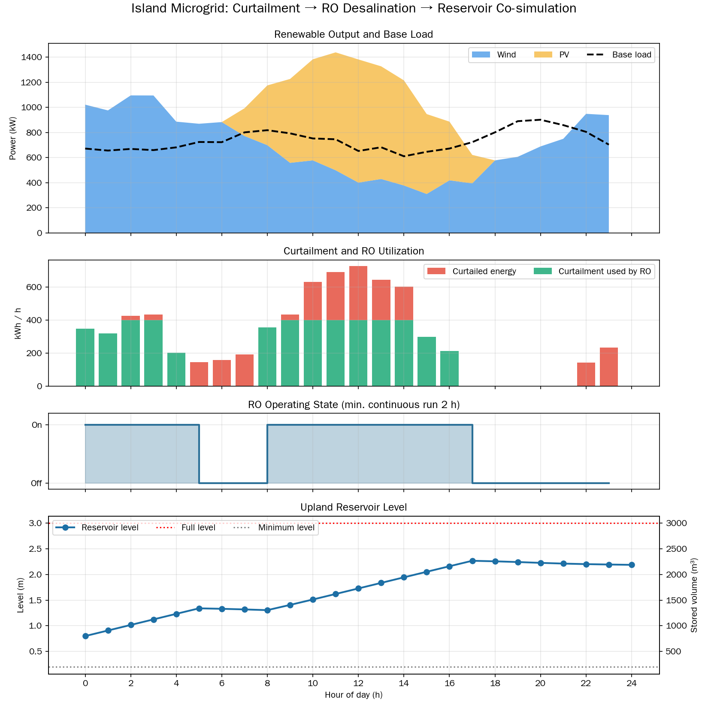

# Early RO simulation demo

This figure is an output screenshot from an earlier synthetic energy–water / reverse-osmosis dispatch demonstration. It illustrates one modeled scenario and its simulation outputs; it is **not** the IslandOS product architecture, the four-step decision workflow, field measurement, or evidence of real-site performance.

For the current product workflow, see the [README](../README.md#the-four-step-decision-workflow). For the current app and technical experiment commands, see [Experiments and workflows](EXPERIMENTS_AND_WORKFLOWS.md).
